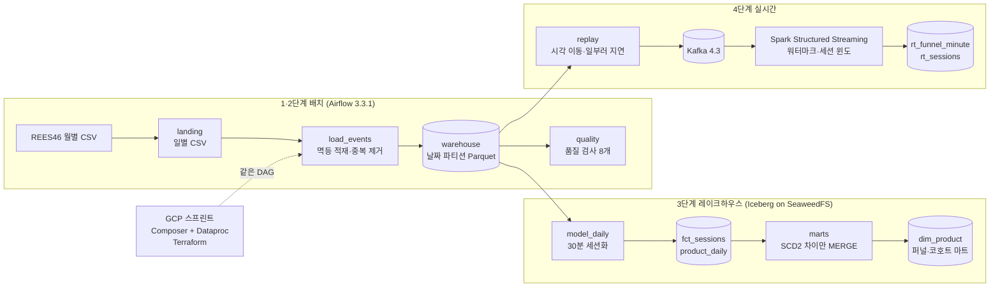

# B2C 이벤트 로그 데이터 파이프라인

실제 이커머스 행동 로그 **4.1억 건**(REES46, 7개월)으로 배치 적재 → 오케스트레이션·품질 검사 → 레이크하우스 모델링 → 실시간 스트리밍까지 구현한 데이터 엔지니어링 학습 포트폴리오입니다. **단계마다 결과를 파이프라인 밖의 독립 계산과 숫자로 대조**했습니다.

설계와 코드는 AI 코딩 에이전트(Claude Code)가 맡았습니다. 저는 학습 방향을 정하고, 만들어진 것을 설명할 수 있게 공부하는 역할을 맡았습니다. 역할 분담은 [만든 방식](#만든-방식)에 있습니다.

| 데이터 | 규모 |
|---|---|
| 기간 | 2019-10 ~ 2020-04 (213일) |
| 이벤트 | 410,325,314건 (보기·장바구니·구매) |
| 사용자 / 상품 | 1,564만 명 / 38.6만 개 |

**기술:** PySpark 4.1.2 · Airflow 3.3.1 · Apache Iceberg 1.12 · SeaweedFS(S3 호환) · Kafka 4.3 · Spark Structured Streaming · Terraform · GCP(Composer 3, Dataproc 3.0, GCS, Storage Transfer) · Docker Compose · pytest(57개)

## 만든 방식
| 누가 | 한 일 |
|---|---|
| Claude Code | 설계와 ADR 작성, 코드와 테스트, 실행 환경(Docker Compose·Terraform), 측정과 대조 |
| 저 | 단계 순서·범위와 기술 선택 같은 학습 방향 결정, 클라우드 비용 승인, 단계마다 받은 질문지(면접형 질문·확인 실험)로 공부해 블로그로 설명하기 |

- 방향 결정은 Claude가 후보와 트레이드오프를 비교해 올리면 제가 골랐습니다. 대부분 추천을 따랐습니다. 3단계 저장소(SeaweedFS + Iceberg)는 학습 가치를 보고 추천(둘 다 넣지 않기)과 다르게 골랐습니다([ADR 0006](docs/decisions/0006-stage3-storage.md)).
- 처음 사흘(10/3~10/5)은 핵심 로직을 직접 짜려 했습니다. 아직 모르는 것을 제가 결정해야 하는 구조에서 막혀, 10/6부터 이 방식으로 바꿨습니다. 경위와 대가는 [회고](docs/portfolio/retrospective.md#학습-방식)에 있습니다.

## 아키텍처


모듈 의존성, DAG 관계, 테이블 ERD, 핵심 로직, 개선점과 코드 리뷰는 [아키텍처 가이드](docs/architecture-guide.md)에 풀어 썼습니다.

## 숫자로 보는 결과
결과마다 "어떻게 맞는지 확인했나"를 같이 적었습니다. 자세한 측정과 해석은 각 ADR에 있습니다.

| 무엇을 | 결과 | 어떻게 확인했나 |
|---|---|---|
| 7개월 배치 백필 (노트북, 동시 3) | 213일·4.1억 행을 **42분**에, 213개 run 모두 성공 | 날짜마다 landing 고유 행 수 = warehouse 행 수(품질 검사) |
| GCP 이전 (Composer + Dataproc) | 같은 DAG로 213일 **3시간 30분**, 재시도 0, 비용 약 ₩1.2만(추정) | 날짜별 행 수가 **213일 모두 로컬과 같다**(410,325,314) |
| 레이크 세션화·SCD2·마트 | 213일 레이크 백필 32분, 상품 버전 610,798개, 마트 재계산 약 60초 | 코호트 크기 합계(15,639,803)와 카테고리 변경 수(168,736)가 독립 쿼리와 같다. 다시 돌리면 dim 커밋 0 |
| SCD2가 지킨 보고서 | 현재 값으로 덮어썼다면(Type-1) **11월 매출의 61%가 '건설 공구'로 옮겨 간다** | 같은 구매를 그때 버전(as-of)과 현재 버전으로 따로 집계 |
| 실시간 정확히 한 번 | 재생 도중 `SIGKILL` 후 재시작해도 **120개 윈도가 배치와 똑같다** | 같은 구간을 배치로 다시 세어 윈도마다 대조 |
| 실시간 세션 | 순서를 5% 뒤섞어 보내도 **세션 103,053개가 배치와 똑같다** | 세션 하나하나(시작·끝·이벤트 수) 대조 |
| 워터마크 5·10·20분 | 버려진 이벤트 3,543 / 1,295 / 0, 상태에 든 윈도 11 / 16 / 26 | 재생 계획을 다시 세워 "버려질 수 있었던 이벤트" 안인지 윈도마다 판정 |

## 그림으로 보기
그림은 [`docs/portfolio/build_viz.py`](docs/portfolio/build_viz.py)가 집계 CSV에서 다시 그립니다. 9장 전체와 각 그림을 어떻게 셌는지는 [그림 모음](docs/portfolio/charts.md)에 있습니다.

<picture>
  <source media="(prefers-color-scheme: dark)" srcset="docs/portfolio/img/daily-dark.svg">
  
</picture>

<picture>
  <source media="(prefers-color-scheme: dark)" srcset="docs/portfolio/img/scd2-dark.svg">
  
</picture>

<picture>
  <source media="(prefers-color-scheme: dark)" srcset="docs/portfolio/img/stream-dark.svg">
  
</picture>

<picture>
  <source media="(prefers-color-scheme: dark)" srcset="docs/portfolio/img/concurrency-dark.svg">
  
</picture>

## 문제를 찾고 푼 이야기
| 문제 | 원인 | 한 일 | 기록 |
|---|---|---|---|
| 성공(DONE)한 Spark 잡이 1월 31일 중 27일을 잃었다 | Dataproc 3.0 기본 커미터(ManifestCommitter)는 같은 폴더에 동시에 쓰면 서로의 작업 공간을 지운다. 공식 문서도 "시험하지 않았다, 데이터를 잃을 수 있다"고 적는다 | 결과물 개수를 세다가 발견했다. Spark 기본 커밋 방식으로 되돌린 뒤 213일을 로컬과 행 단위로 맞췄다 | [ADR 0008](docs/decisions/0008-gcp-sprint.md) |
| 잡 7개가 27분째 실행기를 못 받았다 | YARN이 코어를 센다. 앱마다 관리자(AM) 컨테이너가 코어를 먼저 쥐고 서로 기다렸다 | 실행기를 1코어로 줄이고, 동시에 받는 잡 수를 제한했다 | [ADR 0008](docs/decisions/0008-gcp-sprint.md) |
| 세션 검증이 61일에서 실패했다 | 원천의 세션 id 정의가 2020-03-25에 바뀌었다(원천 세션 길이 중앙값이 하루 만에 0.4분에서 1.5분) | 원천과의 일치율 채점을 버리고, 고장 값을 실측해 고장 감지 바닥을 세웠다 | [ADR 0007](docs/decisions/0007-stage3-modeling.md) |
| 아이폰이 '건설 공구'가 됐다 | 원천이 2019-12-01부터 카테고리를 의미 없이 다시 매겼다 | 상품 이력(SCD2)과 as-of 조인으로 과거 보고서를 지켰고, 그 효과(61%)를 숫자로 보였다 | [ADR 0007](docs/decisions/0007-stage3-modeling.md) |
| 이벤트가 평소의 10%인 날(2/27)과 구매가 0~29건인 날 4일이 품질 검사를 통과했다 | 검사가 그날 데이터만, 이벤트 종류를 나누지 않고 본다. 구매 누락은 원천 월별 파일에도 그대로 있다(압축 파일을 직접 세어 확인) | 그림을 그리다 찾았다. 한계로 기록하고, 최근 날짜 대비·이벤트 종류별 건수 규칙을 다음 개선으로 남겼다. 달별 지표에서는 4일을 뺀다 | [ADR 0007](docs/decisions/0007-stage3-modeling.md) |
| 엔진이 보고한 버린 수(95)와 실제 버린 이벤트(1,295)가 달랐다 | `numRowsDroppedByWatermark`는 이벤트가 아니라 부분 집계된 행을 센다(테스트로 확인) | 대조 기준을 다시 설계했다. 재생 계획을 다시 세워 윈도마다 허용 범위로 판정한다 | [ADR 0009](docs/decisions/0009-stage4-streaming.md) |
| 워터마크보다 늦은 이벤트 중 35%만 버려졌다 | Spark는 늦은 이벤트를 한 배치 전의 워터마크로 거른다. 문서도 "버려진다고 보장되지 않는다"고 적는다 | 테스트 두 개로 동작을 고정하고 대조 기준에 반영했다 | [ADR 0009](docs/decisions/0009-stage4-streaming.md) |
| 일시정지가 없는 Composer가 밤새 켜져 있을 수 있다 | 첫 예산 알림이 약 4일 뒤에야 울린다 | 매일 새벽 2시에 삭제하는 전용 계정·작업을 만들고, 실제로 실행해 지워지는 것까지 확인했다 | [ADR 0008](docs/decisions/0008-gcp-sprint.md) |

## 설계 결정 기록
모든 결정은 후보 비교와 트레이드오프를 담은 ADR로 남겼습니다. ADR은 Claude가 썼습니다. 그중 학습 방향을 바꾼 결정(3단계 저장소, 실시간 엔진, 단계 순서)은 제가 골랐고, 해당 ADR에 '사용자 결정'으로 적혀 있습니다.

| ADR | 결정 |
|---|---|
| [0001](docs/decisions/0001-execution-environment.md) | 실행 환경: 로컬 우선 + GCP 체험판 단기 스프린트 |
| [0002](docs/decisions/0002-stage12-engine.md) | 처리 엔진: PySpark를 1단계부터 써서 Dataproc까지 같은 코드 |
| [0003](docs/decisions/0003-stage1-ingest.md) | 적재: 일별 landing → 날짜 파티션 Parquet, 요청한 날짜만 덮어쓰기, 완전 중복 제거 |
| [0004](docs/decisions/0004-stage2-orchestration.md) | 오케스트레이션: Airflow 일 단위 DAG, 백필, 재시도, 품질 검사 8개, 실패 알림 |
| [0005](docs/decisions/0005-benchmark.md) | 성능 측정: 처리량, 동시 실행 수, 하루씩 vs 한 번에, 병목 |
| [0006](docs/decisions/0006-stage3-storage.md) | 레이크 저장: SeaweedFS 위 Iceberg, Postgres JDBC 카탈로그 |
| [0007](docs/decisions/0007-stage3-modeling.md) | 모델링: 30분 세션, 상품 SCD2(원하는 상태 + 차이 MERGE), 퍼널·코호트 마트, 신선도 관문 |
| [0008](docs/decisions/0008-gcp-sprint.md) | GCP 스프린트: Terraform, 같은 DAG를 환경 변수로 분기, 커밋·YARN 문제 해결 |
| [0009](docs/decisions/0009-stage4-streaming.md) | 실시간: Kafka 재생, Spark Structured Streaming, 워터마크, 정확히 한 번, 실시간 세션 |

잘된 것, 잘못된 것, 다시 한다면 바꿀 것은 [회고](docs/portfolio/retrospective.md)에 정리했습니다.

## 성능 (노트북 Apple M5, Docker VM 9.7GiB)
| 측정 | 결과 |
|---|---|
| 7개월 213일 백필 (Spark 동시 3개) | 42분, 4.1억 행(초당 16.3만 행), 213개 run 모두 성공 |
| 11월 30일 백필, 동시 1·2·3·4개 | 906 · 528 · 401 · 346초. 4개는 메모리 부족으로 1건 실패해서 상한을 3으로 정했다 |
| 11월 적재, 하루씩 30번 vs 한 번에 | 418초 vs 90초 |
| 병목 | 하루치가 gzip 파일 1개라 코어 10개 중 1개로 도는 계산 (CPU 비율 94~99%) |
| 3단계 lake 213일 백필 (Spark 동시 2개) | 32분(1,937초), 213개 run 모두 성공, 하루 중앙값 15.5초 |
| 3단계 마트 전체 재계산 | 약 60초. 상품 버전 61만 개. 다시 돌리면 dim 커밋 0 |
| GCP: 같은 7개월 백필 (Composer + Dataproc 1노드, 동시 4) | 3시간 30분. 하루치 계산은 약 53초이고, 나머지는 YARN·GCS·잡 제출의 고정 비용이다 |
| 실시간: 2시간 구간 75만 건을 60배속 재생 | 배치 처리 중앙값 약 270ms(5초 트리거). 세션 상태 최대 44,215행(36MiB) |

측정 방법과 해석은 [ADR 0005](docs/decisions/0005-benchmark.md), [ADR 0007](docs/decisions/0007-stage3-modeling.md), [ADR 0008](docs/decisions/0008-gcp-sprint.md), [ADR 0009](docs/decisions/0009-stage4-streaming.md)에 있다.

## 실행 방법
Java 21과 [uv](https://docs.astral.sh/uv/)가 필요하다.
```bash
uv sync
curl -C - -o data/raw/2019-Oct.csv.gz https://data.rees46.com/datasets/marketplace/2019-Oct.csv.gz
.venv/bin/python -m pipeline.split_raw data/raw/2019-Oct.csv.gz --landing data/landing/events
.venv/bin/python -m pipeline.load_events --start 2019-10-01 --end 2019-10-31 --landing data/landing/events --warehouse data/warehouse/events
bash jars/fetch.sh   # Iceberg·Kafka 커넥터 jar 7개(체크섬 대조). 테스트 세션이 함께 올린다
.venv/bin/python -m pytest -q
```

자동 실행(Airflow, http://localhost:8080):
```bash
cp .env.example .env    # JWT 키와 S3 키(LAKE_S3_*)를 채운다
docker compose up -d --build
docker compose exec airflow-scheduler airflow backfill create --dag-id events_daily --from-date 2019-10-01 --to-date 2019-10-31 --max-active-runs 2
# 3단계: events 품질 검사를 통과한 날짜를 lake로 → 끝나면 SCD2와 마트를 한 번에 다시 계산
docker compose exec airflow-scheduler airflow backfill create --dag-id lake_daily --from-date 2019-10-01 --to-date 2019-10-31 --max-active-runs 2
docker compose exec airflow-scheduler airflow dags trigger lake_marts
# 4단계: Kafka를 띄우고, 재생 + 실시간 집계 + 배치 대조를 한 번에(도중 강제 종료는 --kill-after 초)
docker compose --profile stream up -d kafka
bench/stream_once.sh events_e1
JOB=sessions bench/stream_once.sh events_s1 -- --very-late 0 --tick-minutes 45
```

GCP 스프린트(`infra/`, 비용 발생):
```bash
terraform -chdir=infra apply -var enable_composer=true -var enable_dataproc=true
infra/deploy.sh && infra/split.sh
terraform -chdir=infra apply   # 같은 날 관리형 서비스를 지운다
```

## 저장소 구조
```
pipeline/       Spark 작업(적재·품질·세션화·마트·재생·실시간)과 lake 테이블 정의
dags/           Airflow DAG(events_daily, lake_daily, lake_marts)와 공용 헬퍼
tests/          호스트 테스트 57개(로컬 Spark + hadoop 카탈로그, 스트리밍은 파일 소스로)
infra/          GCP Terraform, 코드 배포·일별 분할 스크립트
bench/          측정 스크립트와 결과(백필 시간·메모리, 실시간 실험)
docs/decisions/ ADR 0001~0009
docs/blog-prompts/ 단계별 질문지(면접형 질문, 직접 돌려 볼 실험, 공식 문서)
docs/portfolio/  그림 생성기와 결과(img/, charts.md, report.html), 회고, 이력서 문장 초안
```

## 운영 메모: lake 초기화 (3단계)
| 목적 | 명령 | 결과 |
|---|---|---|
| lake만 다시 만들기 | `docker compose exec airflow-scheduler python -m pipeline.lake reset` 뒤 lake 백필 | 테이블과 파일을 지우고(PURGE) 다시 만든다. events는 건드리지 않는다 |
| 전부 초기화 | `docker compose down -v` → `up -d` → events_daily 백필 → lake 백필 | Postgres 볼륨(Airflow 메타데이터 + 카탈로그)과 SeaweedFS 볼륨이 함께 지워진다. `./data`는 남는다 |
| 하면 안 되는 것 | 볼륨 하나만 `docker volume rm` | 카탈로그와 파일이 어긋난다. 그러면 '전부 초기화'로 맞춘다 |

## 데이터 출처
REES46 eCommerce behavior data from multi category store ([Kaggle](https://www.kaggle.com/datasets/mkechinov/ecommerce-behavior-data-from-multi-category-store), 7개월 전체는 data.rees46.com). 라이선스상 재배포할 수 없어 데이터는 저장소와 공개 버킷에 올리지 않는다.
