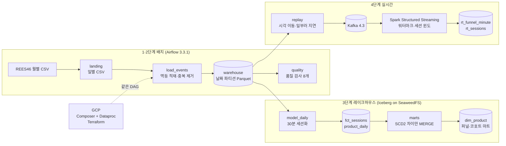

# B2C 이벤트 로그: 시뮬레이션 환경에서 가설 검증까지

실제 이커머스 행동 로그 **4.1억 건**(REES46, 2019-10 ~ 2020-04)으로 **운영 중인 쇼핑몰을 흉내 내는 시뮬레이션 환경**을 만들었습니다. 이 환경에서는 로그가 매일 쌓이고, 실시간으로 늦게·뒤섞여 들어오고, 처리 도중 잡이 죽습니다.

그 위에서 B2C 지표(전환율·카테고리 매출·재방문)를 낼 때 생길 문제를 **가설 7개**로 세웠습니다. 가설을 검증하는 데 필요한 **데이터 파이프라인**(배치 적재 → 품질 검사 → 레이크하우스 모델링 → 실시간 집계)을 만들고 **분석**까지 진행했습니다. 판정은 모두 파이프라인 밖의 독립 계산과 숫자로 대조한 뒤에 내렸습니다. 가설 3개는 맞았고, 3개는 틀렸고, 1개는 일부만 맞았습니다.


| 데이터 | 규모 |
|---|---|
| 기간 | 2019-10 ~ 2020-04 (213일) |
| 이벤트 | 410,325,314건 (보기·장바구니·구매) |
| 사용자 / 상품 | 1,564만 명 / 38.6만 개 |

**기술:** PySpark 4.1.2 · Airflow 3.3.1 · Apache Iceberg 1.12 · SeaweedFS(S3 호환) · Kafka 4.3 · Spark Structured Streaming · Terraform · GCP(Composer 3, Dataproc 3.0, GCS, Storage Transfer) · Docker Compose · pytest(57개)

## 1. 시뮬레이션 환경
받은 데이터는 앱이 처음 남긴 원본 로그가 아닙니다. REES46이 한 번 가공해 내보낸 월별 파일이라, 시간 순서가 완벽히 정렬돼 있고 세션도 이미 나뉘어 있으며 깨진 행이 없습니다(10월분 전수 확인). 이대로는 운영에서 겪는 문제가 드러나지 않습니다. 그래서 운영 조건을 하나씩 만들었습니다.

| 운영에서 일어나는 일 | 시뮬레이션에서 만든 것 | 코드 |
|---|---|---|
| 앱 로그가 하루 단위로 쌓인다 | 월별 CSV를 UTC 날짜별 landing 파일(gzip)로 나눈다 | `pipeline/split_raw.py` |
| 하루가 끝나면 그 하루를 처리하고, 지난 날짜는 다시 처리한다 | Airflow 일 단위 DAG가 `{{ ds }}` 하루를 처리한다. 지난 213일은 백필로 돌린다 | `dags/events_daily.py` |
| 같은 로그가 두 번 들어온다 | 원천에 섞인 완전 중복 행(10월만 30,220행)이 있고, 재시도·백필로 같은 날짜를 다시 쓴다 | `pipeline/load_events.py` |
| 이벤트가 실시간으로, 늦게, 순서가 뒤바뀌어 온다 | 이벤트 시각을 현재로 옮겨 Kafka로 60배속 재생한다. 5%는 0~8분, 0.5%는 15~20분 일부러 늦춘다(시드 고정이라 다시 돌리면 같다) | `pipeline/replay.py` |
| 처리 도중 프로세스가 죽는다 | 재생 도중 스트리밍 잡을 `SIGKILL`로 죽이고, 같은 체크포인트로 다시 띄운다 | `bench/stream_once.sh --kill-after` |
| 노트북이 아니라 관리형 클라우드에서 돈다 | 같은 DAG를 GCP Composer 3 + Dataproc 3.0으로 옮겨 213일을 돌린다 | `infra/` |

## 2. 문제와 가설
핵심 질문은 하나입니다. **"이 로그로 B2C 지표를 내면, 그 숫자를 믿을 수 있는가?"** 이 질문을 지표 질문 셋(H1~H3)과 데이터·처리 질문 넷(H4~H7)으로 나눠 가설을 세웠습니다.

| | 질문 | 가설 | 검증 방법 |
|---|---|---|---|
| H1 | 달마다 구매 전환은 어떻게 변하나 | 10월은 장바구니가 덜 기록돼, 장바구니를 거치는 지표로는 달끼리 비교할 수 없다. 세션 전환율(구매가 있는 세션의 비율)은 영향을 받지 않는다 | 세션 퍼널 마트를 달별로 합산 |
| H2 | 카테고리별 매출을 기간을 넘어 볼 수 있나 | 상품 카테고리가 바뀌므로, 현재 카테고리로 과거 매출을 묶으면(Type-1) 과거 보고서가 바뀐다 | 11월 구매를 그때 버전(SCD2 as-of 조인)과 현재 버전으로 따로 집계 |
| H3 | 새로 온 사용자는 다음 달에 다시 오나 | 첫 달(10월) 코호트에는 데이터 시작 전부터 오던 사용자가 섞여 재방문율이 부풀어 있다 | 첫 방문 달 기준 월 코호트 마트 |
| H4 | 원천의 세션 id를 정답으로 삼아도 되나 | 원천 `user_session`은 30분 비활동 세션과 7개월 내내 비슷한 수준으로 맞는다 | 날짜별 세션 경계의 정밀도·재현율 |
| H5 | 품질 검사를 통과한 날의 지표는 믿어도 되나 | 건수·결측·중복 검사 8개를 통과하면 그날 데이터는 정상이다 | 날짜별 이벤트·구매 수를 그리고, 원천 월별 파일을 직접 세어 대조 |
| H6 | 늦고 뒤섞여 오는 실시간 집계가 배치와 같은 답을 내나 | 워터마크(10분)보다 덜 늦은 이벤트는 모두 반영되고, 더 늦은 이벤트는 버려지며 엔진이 그 수를 보고한다. 중간에 죽어도 한 번만 반영된다 | 같은 구간을 배치로 다시 세어 1분 윈도·세션마다 대조 |
| H7 | 같은 파이프라인을 클라우드로 옮겨도 결과가 같은가 | DAG와 코드가 같으면 결과도 같다 | 날짜별 행 수를 로컬과 213일 대조 |

## 3. 데이터 파이프라인


| 단계 | 하는 일 | 검증하는 가설 | 설계 기록 |
|---|---|---|---|
| 1. 수집·적재 | 일별 landing → 날짜 파티션 zstd Parquet. 요청한 날짜만 덮어써서 몇 번을 다시 돌려도 결과가 같다(멱등). 완전 중복을 지운다 | 모든 분석의 바탕 | [0003](docs/decisions/0003-stage1-ingest.md) |
| 2. 오케스트레이션·품질 | Airflow 일 단위 DAG, 백필, 재시도, 품질 검사 8개, 실패하면 Slack 알림. 같은 DAG를 환경 변수로 GCP에 분기 | H5, H7 | [0004](docs/decisions/0004-stage2-orchestration.md) · [0005](docs/decisions/0005-benchmark.md) · [0008](docs/decisions/0008-gcp-sprint.md) |
| 3. 레이크하우스 모델링 | SeaweedFS 위 Iceberg. 30분 비활동 세션(`fct_sessions`), 상품 이력 SCD2(`dim_product`), 퍼널·코호트 마트 | H1~H4 | [0006](docs/decisions/0006-stage3-storage.md) · [0007](docs/decisions/0007-stage3-modeling.md) |
| 4. 실시간 | Kafka → Spark Structured Streaming. 1분 퍼널과 세션 윈도, 워터마크 10분, Iceberg append로 정확히 한 번 | H6 | [0009](docs/decisions/0009-stage4-streaming.md) |

## 4. 분석 결과
| | 판정 | 핵심 숫자 | 대응 |
|---|---|---|---|
| H1 | 맞음 | 구매 1건당 장바구니가 10월 1.2, 다른 달 2.5~3.0이다. 세션 전환율은 10월 7.5%로 다른 달(6.1~7.7%) 범위 안이다 | 달끼리 비교하는 기본 지표를 세션 전환율로 정했다 |
| H2 | 맞음 | 현재 카테고리로 묶으면 11월 매출의 82.7%가 다른 상위 카테고리로 옮겨 간다. 가장 큰 흐름은 전자제품 → '건설 공구'로, 11월 매출의 61%다. 원천이 2019-12-01부터 아이폰을 `construction.tools.light`로 내보낸다 | 상품 이력(SCD2)과 as-of 조인으로 과거 구매를 그때의 카테고리로 센다 |
| H3 | 맞음 | 다음 달 재방문율이 10월 코호트 46.4%, 11월 35.8%, 이후 점점 내려가 3월 20.4%다. 늦게 들어온 코호트일수록 낮다 | 10월 코호트는 좌측 절단으로 표시하고, 비교는 11월 코호트부터 한다 |
| H4 | 틀림 | 2020-03-25 하루 만에 정밀도가 0.87 → 0.75, 재현율이 0.35 → 0.58로 바뀐다. 원천 세션 길이 중앙값은 0.4분 → 1.5분이 됐고, 우리 세션 수는 그대로다. 원천이 세션 정의를 바꿨다 | 원천과의 일치율 채점을 버렸다. 일부러 고장 낸 세션의 값을 재서 고장 감지 바닥(정밀도 0.50, 재현율 0.05)을 세웠다 |
| H5 | 틀림 | 8개를 모두 통과한 날 가운데 이벤트가 평소의 10%인 날(2020-02-27)과 구매가 0~29건인 날 4일(하루 중앙값 27,510건)이 있다. 구매가 빠진 날은 원천 월별 파일을 직접 세어도 같은 수다 | 날짜별 전환율·매출에서 이 날들을 빼거나 표시한다. 최근 날짜 대비·이벤트 종류별 건수 규칙을 다음 개선으로 남겼다 |
| H6 | 일부 맞음 | 재생 도중 강제 종료해도 1분 윈도 120개가 배치와 같다. 5%를 뒤섞어 보내도 세션 103,053개가 하나하나 같다. 그러나 워터마크보다 늦게 보낸 3,744건 중 1,295건(35%)만 버려졌고, 엔진은 버린 수를 95로 보고했다 | Spark는 늦은 이벤트를 한 배치 전 워터마크로 거르고, 그 지표는 이벤트가 아니라 부분 집계 행을 센다(테스트로 고정). 대조 기준을 '윈도마다 허용 범위'로 다시 설계했다 |
| H7 | 틀림 | Dataproc 기본 커미터(ManifestCommitter)가 같은 폴더 동시 쓰기에서 1월 31일 중 27일을 잃었는데도 잡은 성공(DONE)으로 끝났다 | Spark 기본 커밋 방식으로 되돌렸다. 그 뒤 213일 날짜별 행 수가 로컬과 모두 같다(410,325,314) |

### 그림으로 보기
그림은 [`docs/portfolio/build_viz.py`](docs/portfolio/build_viz.py)가 집계 CSV에서 다시 그립니다. 9장 전체와 각 그림을 어떻게 셌는지는 [그림 모음](docs/portfolio/charts.md)에 있습니다.

**H1. 10월의 함정과 기본 지표**
<picture>
  <source media="(prefers-color-scheme: dark)" srcset="docs/portfolio/img/funnel-dark.svg">
  
</picture>

**H2. SCD2가 지킨 11월 매출**
<picture>
  <source media="(prefers-color-scheme: dark)" srcset="docs/portfolio/img/scd2-dark.svg">
  
</picture>

**H3. 월 코호트 재방문율**
<picture>
  <source media="(prefers-color-scheme: dark)" srcset="docs/portfolio/img/cohort-dark.svg">
  
</picture>

**H4. 원천 세션 정의가 바뀐 날**
<picture>
  <source media="(prefers-color-scheme: dark)" srcset="docs/portfolio/img/session_pr-dark.svg">
  
</picture>

**H5. 품질 검사를 통과한 원천 결함**
<picture>
  <source media="(prefers-color-scheme: dark)" srcset="docs/portfolio/img/daily-dark.svg">
  
</picture>

**H6. 실시간 1분 집계에서 빠진 이벤트**
<picture>
  <source media="(prefers-color-scheme: dark)" srcset="docs/portfolio/img/stream-dark.svg">
  
</picture>

## 5. 결론
1. **원천 데이터는 운영 중에 조용히 바뀐다.** 카테고리 재부여(2019-12-01), 세션 정의 변경(2020-03-25), 10월 장바구니 누락은 모두 오류 없이 들어왔다. 그날 데이터만 보는 검사로는 보이지 않는다.
2. **그래서 지표의 정의를 원천에 기대지 않게 만들었다.** 세션은 우리 규칙(30분 비활동 + UTC 자정)으로 나누고, 카테고리는 그때의 버전으로 세고, 달끼리 비교는 장바구니를 거치지 않는 세션 전환율로 한다.
3. **"성공"은 "정답"이 아니다.** 성공한 클라우드 잡이 데이터를 잃었고, 엔진이 보고한 버린 수는 실제와 달랐다. 결과는 파이프라인 밖의 독립 계산과 맞춰 본 뒤에만 믿는다.
4. **남은 일:** 품질 규칙에 최근 7일 중앙값 대비 건수와 이벤트 종류별 건수를 넣는다. 기간을 가로지르는 카테고리 분석에는 옛·새 `category_id` 대응표가 필요하다.

잘된 것, 잘못된 것, 다시 한다면 바꿀 것은 [회고](docs/portfolio/retrospective.md)에 정리했습니다.

## 파이프라인 성능 (노트북 Apple M5, Docker VM 9.7GiB)
| 측정 | 결과 |
|---|---|
| 7개월 213일 백필 (Spark 동시 3개) | 42분, 4.1억 행(초당 16.3만 행), 213개 run 모두 성공 |
| 11월 30일 백필, 동시 1·2·3·4개 | 906 · 528 · 401 · 346초. 4개는 메모리 부족으로 1건 실패해서 상한을 3으로 정했다 |
| 11월 적재, 하루씩 30번 vs 한 번에 | 418초 vs 90초 |
| 병목 | 하루치가 gzip 파일 1개라 코어 10개 중 1개로 도는 계산 (CPU 비율 94~99%) |
| 3단계 lake 213일 백필 (Spark 동시 2개) | 32분(1,937초), 213개 run 모두 성공, 하루 중앙값 15.5초 |
| 3단계 마트 전체 재계산 | 약 60초. 상품 버전 61만 개. 다시 돌리면 dim 커밋 0 |
| GCP: 같은 7개월 백필 (Composer + Dataproc 1노드, 동시 4) | 3시간 30분, 재시도 0, 비용 약 ₩1.2만(추정). 하루치 계산은 약 53초이고, 나머지는 YARN·GCS·잡 제출의 고정 비용이다 |
| 실시간: 2시간 구간 75만 건을 60배속 재생 | 배치 처리 중앙값 약 270ms(5초 트리거). 세션 상태 최대 44,215행(36MiB) |

운영 중 만난 문제도 두 가지 더 있었다.
- **YARN 잡 7개가 27분째 실행기를 못 받았다.** 앱마다 관리자(AM) 컨테이너가 코어를 먼저 쥐고 서로 기다렸다. 실행기를 1코어로 줄이고 동시에 받는 잡 수를 제한했다([ADR 0008](docs/decisions/0008-gcp-sprint.md)).
- **일시정지가 없는 Composer가 밤새 켜져 있을 수 있다.** 첫 예산 알림이 약 4일 뒤에야 울린다. 매일 새벽 2시에 환경을 지우는 작업을 만들고, 실제로 실행해 지워지는 것까지 확인했다([ADR 0008](docs/decisions/0008-gcp-sprint.md)).

측정 방법과 해석은 [ADR 0005](docs/decisions/0005-benchmark.md), [ADR 0007](docs/decisions/0007-stage3-modeling.md), [ADR 0008](docs/decisions/0008-gcp-sprint.md), [ADR 0009](docs/decisions/0009-stage4-streaming.md)에 있다.

## 설계 결정 기록
모든 결정은 후보 비교와 트레이드오프를 담은 ADR로 남겼습니다.

| ADR | 결정 |
|---|---|
| [0001](docs/decisions/0001-execution-environment.md) | 실행 환경: 로컬 우선 + GCP 체험판 단기 스프린트 |
| [0002](docs/decisions/0002-stage12-engine.md) | 처리 엔진: PySpark를 1단계부터 써서 Dataproc까지 같은 코드 |
| [0003](docs/decisions/0003-stage1-ingest.md) | 적재: 일별 landing → 날짜 파티션 Parquet, 요청한 날짜만 덮어쓰기, 완전 중복 제거 |
| [0004](docs/decisions/0004-stage2-orchestration.md) | 오케스트레이션: Airflow 일 단위 DAG, 백필, 재시도, 품질 검사 8개, 실패 알림 |
| [0005](docs/decisions/0005-benchmark.md) | 성능 측정: 처리량, 동시 실행 수, 하루씩 vs 한 번에, 병목 |
| [0006](docs/decisions/0006-stage3-storage.md) | 레이크 저장: SeaweedFS 위 Iceberg, Postgres JDBC 카탈로그 |
| [0007](docs/decisions/0007-stage3-modeling.md) | 모델링: 30분 세션, 상품 SCD2(원하는 상태 + 차이 MERGE), 퍼널·코호트 마트, 신선도 관문 |
| [0008](docs/decisions/0008-gcp-sprint.md) | GCP 이전: Terraform, 같은 DAG를 환경 변수로 분기, 커밋·YARN 문제 해결 |
| [0009](docs/decisions/0009-stage4-streaming.md) | 실시간: Kafka 재생, Spark Structured Streaming, 워터마크, 정확히 한 번, 실시간 세션 |

## 실행 방법
Java 21과 [uv](https://docs.astral.sh/uv/)가 필요하다.
```bash
uv sync
curl -C - -o data/raw/2019-Oct.csv.gz https://data.rees46.com/datasets/marketplace/2019-Oct.csv.gz
.venv/bin/python -m pipeline.split_raw data/raw/2019-Oct.csv.gz --landing data/landing/events
.venv/bin/python -m pipeline.load_events --start 2019-10-01 --end 2019-10-31 --landing data/landing/events --warehouse data/warehouse/events
bash jars/fetch.sh   # Iceberg·Kafka 커넥터 jar 7개(체크섬 대조). 테스트 세션이 함께 올린다
.venv/bin/python -m pytest -q
```

자동 실행(Airflow, http://localhost:8080):
```bash
cp .env.example .env    # JWT 키와 S3 키(LAKE_S3_*)를 채운다
docker compose up -d --build
docker compose exec airflow-scheduler airflow backfill create --dag-id events_daily --from-date 2019-10-01 --to-date 2019-10-31 --max-active-runs 2
# 3단계: events 품질 검사를 통과한 날짜를 lake로 → 끝나면 SCD2와 마트를 한 번에 다시 계산
docker compose exec airflow-scheduler airflow backfill create --dag-id lake_daily --from-date 2019-10-01 --to-date 2019-10-31 --max-active-runs 2
docker compose exec airflow-scheduler airflow dags trigger lake_marts
# 4단계: Kafka를 띄우고, 재생 + 실시간 집계 + 배치 대조를 한 번에(도중 강제 종료는 --kill-after 초)
docker compose --profile stream up -d kafka
bench/stream_once.sh events_e1
JOB=sessions bench/stream_once.sh events_s1 -- --very-late 0 --tick-minutes 45
```

GCP(`infra/`, 비용 발생):
```bash
terraform -chdir=infra apply -var enable_composer=true -var enable_dataproc=true
infra/deploy.sh && infra/split.sh
terraform -chdir=infra apply   # 같은 날 관리형 서비스를 지운다
```

## 저장소 구조
```
pipeline/       Spark 작업(적재·품질·세션화·마트·재생·실시간)과 lake 테이블 정의
dags/           Airflow DAG(events_daily, lake_daily, lake_marts)와 공용 헬퍼
tests/          호스트 테스트 57개(로컬 Spark + hadoop 카탈로그, 스트리밍은 파일 소스로)
infra/          GCP Terraform, 코드 배포·일별 분할 스크립트
bench/          측정 스크립트와 결과(백필 시간·메모리, 실시간 실험)
docs/decisions/ ADR 0001~0009
docs/blog-prompts/ 단계별 질문지(면접형 질문, 직접 돌려 볼 실험, 공식 문서)
docs/portfolio/  그림 생성기와 결과(img/, charts.md, report.html), 회고, 이력서 문장 초안
```

## 운영 메모: lake 초기화 (3단계)
| 목적 | 명령 | 결과 |
|---|---|---|
| lake만 다시 만들기 | `docker compose exec airflow-scheduler python -m pipeline.lake reset` 뒤 lake 백필 | 테이블과 파일을 지우고(PURGE) 다시 만든다. events는 건드리지 않는다 |
| 전부 초기화 | `docker compose down -v` → `up -d` → events_daily 백필 → lake 백필 | Postgres 볼륨(Airflow 메타데이터 + 카탈로그)과 SeaweedFS 볼륨이 함께 지워진다. `./data`는 남는다 |
| 하면 안 되는 것 | 볼륨 하나만 `docker volume rm` | 카탈로그와 파일이 어긋난다. 그러면 '전부 초기화'로 맞춘다 |

## 만든 방식
설계·코드·테스트는 AI 코딩 에이전트(Claude Code)가 맡았습니다. 단계 순서와 범위, 기술 선택(3단계 저장소, 실시간 엔진)은 제가 정했고, 해당 ADR에 '사용자 결정'으로 남아 있습니다.

## 데이터 출처
REES46 eCommerce behavior data from multi category store ([Kaggle](https://www.kaggle.com/datasets/mkechinov/ecommerce-behavior-data-from-multi-category-store), 7개월 전체는 data.rees46.com). 라이선스상 재배포할 수 없어 데이터는 저장소와 공개 버킷에 올리지 않는다.
