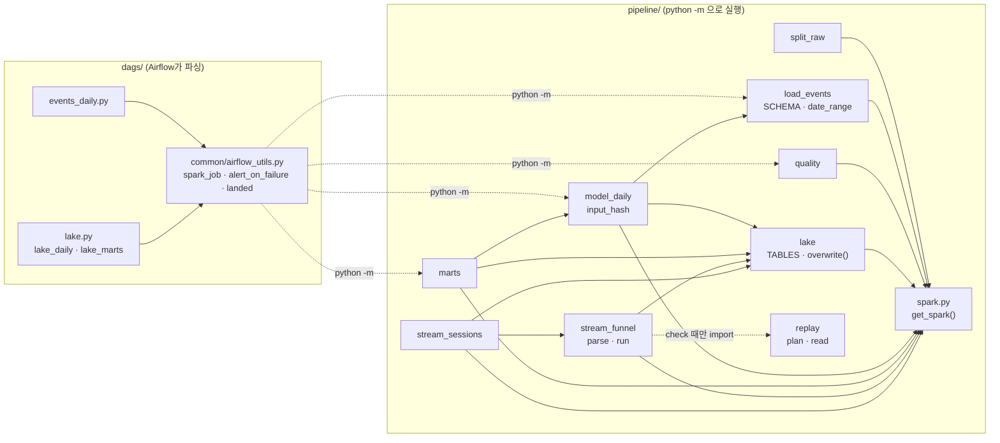
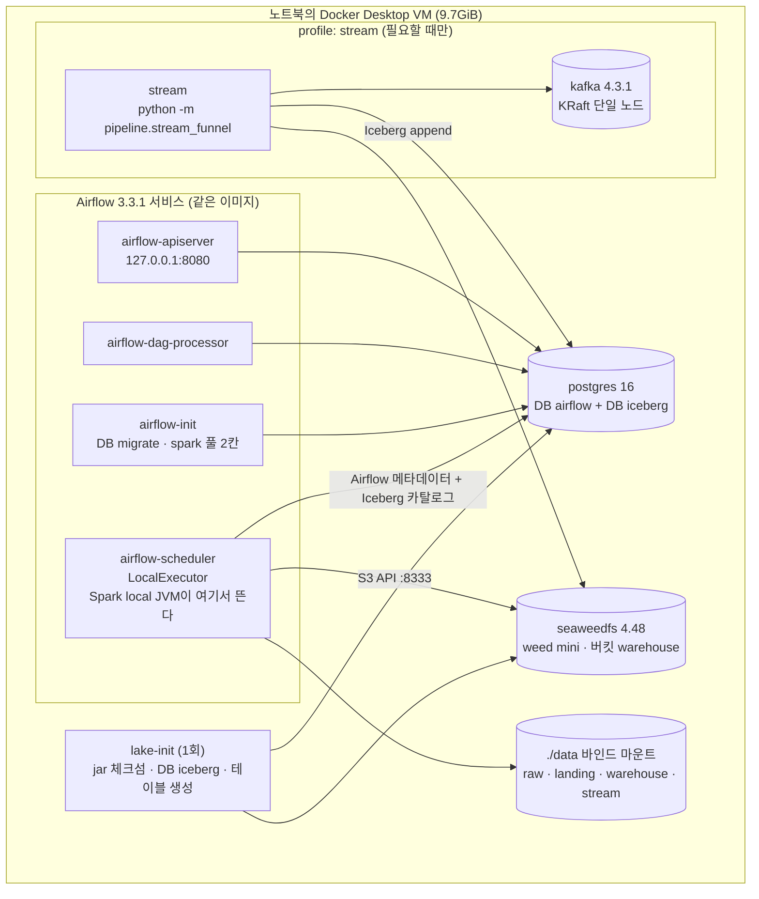
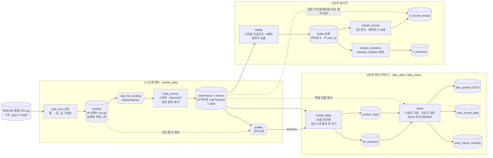
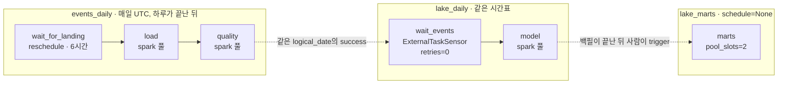
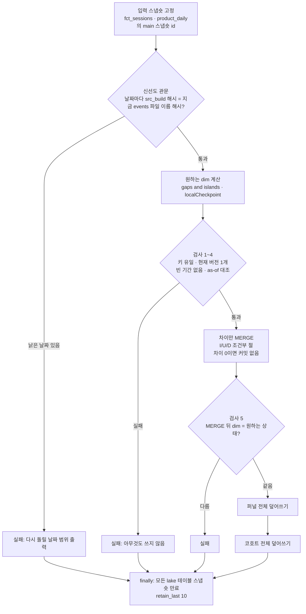
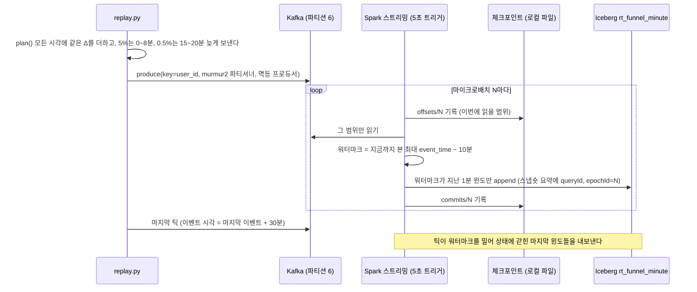
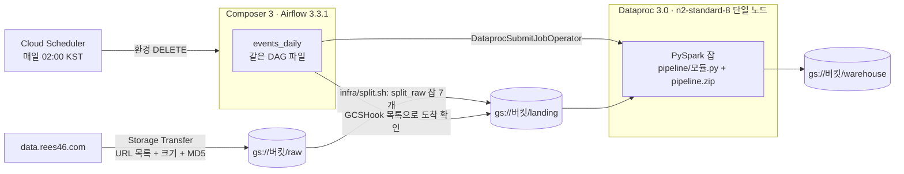
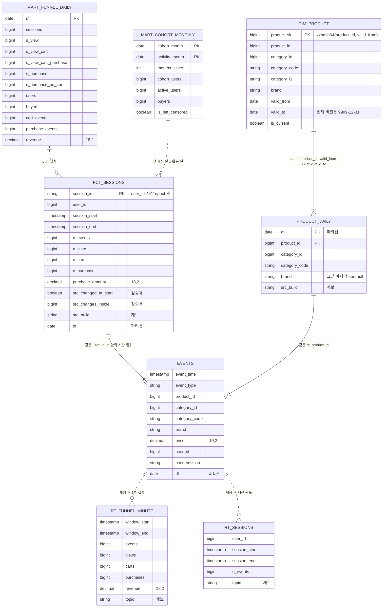

# 아키텍처 가이드: 이벤트 로그가 마트와 실시간 집계가 되기까지

주니어 데이터 엔지니어가 이 저장소를 처음 열었을 때 "무엇이 어디서 어떻게 도는가"를 한 번에 잡도록 쓴 교육 자료다.

- **기준:** 커밋 `8810f6f`(2026-10-15). 코드, ADR 0001~0009, 회고에 적힌 사실만 쓴다. 문서 숫자를 다시 계산한 값은 **(추정)**, 이 문서를 쓰면서 직접 돌려 본 것은 **(2026-10-15 확인)**으로 표시한다.
- **근거 표기:** `파일:줄`로 단다. 줄 번호는 위 커밋 기준이다. ADR은 `docs/decisions/`에 있다.
- **(2026-10-15 확인)** 호스트에서 `pytest` 57개가 모두 통과했다(119초, Java 21, PySpark 4.1.2, jar 7개 체크섬 일치).

## 목차
1. [시스템 아키텍처 요약](#1-시스템-아키텍처-요약)
2. [디렉토리와 모듈](#2-디렉토리와-모듈)
3. [데이터 흐름도](#3-데이터-흐름도)
4. [데이터 모델과 스키마](#4-데이터-모델과-스키마)
5. [핵심 로직 따라 읽기](#5-핵심-로직-따라-읽기)
6. [최적화·개선 포인트](#6-최적화개선-포인트)
7. [코드 리뷰](#7-코드-리뷰)
8. [학습 경로와 자가 점검](#8-학습-경로와-자가-점검)

---

## 1. 시스템 아키텍처 요약

이 프로젝트는 REES46 이커머스 행동 로그 7개월치(213일, 410,325,314건)를 처리하는 학습용 파이프라인이다. 배치 쪽은 Docker Compose로 띄운 Airflow 3.3.1(LocalExecutor) 컨테이너 안에서 PySpark 4.1.2를 `local[*]` 모드로 돌린다. 월별 원본 CSV를 하루 단위 landing 파일로 한 번 나누고(`split_raw`), 매일 그 하루를 타입을 입힌 날짜 파티션 zstd Parquet로 적재한 뒤(`load_events`), 품질 규칙 8개로 검사한다(`quality`). 스케줄은 "하루가 끝난 뒤 그 하루"를 처리하는 `CronDataIntervalTimetable`이고, 지난 날짜는 백필로 돌린다.

3단계는 같은 Spark에 Apache Iceberg 1.12를 붙여 레이크하우스를 만든다. 테이블 파일은 S3 호환 저장소 SeaweedFS(`weed mini`)에 두고, 테이블 포인터(카탈로그)는 Airflow와 같은 Postgres 안의 JDBC 카탈로그에 둔다. `model_daily`가 하루치 이벤트를 30분 비활동 기준 세션(`fct_sessions`)과 상품 하루 스냅숏(`product_daily`)으로 만들고, `marts`가 전체 기간에서 상품 이력(SCD2 `dim_product`)과 퍼널·코호트 마트를 다시 계산한다. 4단계는 warehouse의 한 시간 구간을 시각만 현재로 옮겨 Kafka 4.3.1(단일 브로커 KRaft)로 재생하고, Spark Structured Streaming이 1분 윈도 퍼널과 사용자별 세션을 Iceberg에 append한다. 1·2단계 DAG는 Terraform으로 만든 GCP Composer 3 + Dataproc 3.0에서도 환경 변수 두 개로 분기해 같은 코드로 돌았다.

설계를 꿰는 원칙은 네 가지다. ① **날짜가 단위다.** 하루치 결과는 그날 입력만의 순수 함수이고, 같은 날짜를 다시 돌리면 그 날짜만 통째로 갈아 끼운다(멱등). ② **날짜를 가로지르는 결과(SCD2, 코호트)는 매번 전체에서 다시 계산**하고, 증분 상태를 들고 다니지 않는다. dim에는 차이만 반영한다. ③ **쓰기 전에 검사한다.** 실패한 날의 데이터가 다음 단계로 흘러가지 않는다. ④ **결과를 파이프라인 밖의 독립 계산과 숫자로 맞춘다.** landing 고유 행 수 = warehouse 행 수, 로컬 = Dataproc, 배치 = 실시간처럼 단계마다 대조했다.

### 기술 스택 한눈에
| 층 | 기술(버전) | 어디서 정하나 | 역할 |
|---|---|---|---|
| 처리 엔진 | PySpark 4.1.2, Java 21 | `pyproject.toml`, `docker/airflow.Dockerfile` | 배치와 스트리밍 모두 |
| 오케스트레이션 | Airflow 3.3.1, LocalExecutor | `docker-compose.yml`, `dags/` | 일 단위 DAG, 백필, 재시도, 실패 알림 |
| 파일 포맷 | CSV.gz → Parquet(zstd) | `pipeline/split_raw.py`, `pipeline/load_events.py` | landing, warehouse |
| 테이블 포맷 | Apache Iceberg 1.12(format v2) | `pipeline/lake.py`, `jars/` | 원자적 커밋, MERGE, 스냅숏 |
| 오브젝트 저장소 | SeaweedFS 4.48(`weed mini`) | `docker-compose.yml:72` | Iceberg 데이터·메타데이터 파일 |
| 카탈로그 | Postgres 16 안 JDBC 카탈로그 | `docker-compose.yml:36` | 테이블 이름 → 현재 `metadata.json` 포인터 |
| 메시지 큐 | Kafka 4.3.1(KRaft 단일 노드) | `docker-compose.yml:175` | 재생한 이벤트 |
| 스트리밍 | Spark Structured Streaming | `pipeline/stream_funnel.py`, `pipeline/stream_sessions.py` | 워터마크, 윈도, 정확히 한 번 |
| 클라우드 | GCP Composer 3, Dataproc 3.0, GCS, Storage Transfer | `infra/main.tf` | 같은 DAG를 클라우드에서 |
| 테스트 | pytest 57개 | `tests/` | 로컬 Spark + hadoop 카탈로그 + 파일 스트리밍 소스 |

---

## 2. 디렉토리와 모듈

### 2-1. 디렉토리 역할과 의존 방향
| 디렉토리 | 역할 | 이것이 기대는 것 | 이것에 기대는 것 |
|---|---|---|---|
| `pipeline/` | Spark 작업 본체. 모듈 하나가 `python -m pipeline.<모듈>`로 도는 엔트리포인트 하나다 | `pyspark`, `jars/`(lake·Kafka 커넥터), 환경 변수 `LAKE_*`·`AWS_*` | `dags/`(프로세스로 부름), `tests/`, `bench/`, `infra/`(GCS로 복사) |
| `dags/` | Airflow DAG 3개(`events_daily`, `lake_daily`, `lake_marts`) | `dags/common/`. `pipeline/`은 **import하지 않는다** | Airflow dag-processor·scheduler, Composer |
| `dags/common/` | `spark_job()`, 실패 알림 콜백, 재시도 기본값, landing 도착 확인 | Airflow providers(standard, google, slack) | `dags/events_daily.py`, `dags/lake.py` |
| `tests/` | 호스트 테스트 57개. 엔진 동작을 고정하는 '학습 테스트'를 포함한다 | `pipeline/`, `jars/` | 개발자 |
| `jars/` | Iceberg·Postgres·Kafka 커넥터 jar 7개를 받는 스크립트와 `SHA256SUMS` | Maven Central | `pipeline/spark.py`(클래스패스), `lake-init` |
| `docker/` | Airflow 이미지 = Airflow 3.3.1 + JRE 21 + PySpark 4.1.2 + confluent-kafka | 공식 이미지 두 개 | `docker-compose.yml` |
| `infra/` | GCP Terraform, 코드 배포(`deploy.sh`), 월→일 분할 잡 제출(`split.sh`) | `pipeline/`, `dags/` | 스프린트 당일의 사람 |
| `bench/` | 측정 스크립트와 결과 CSV | 떠 있는 compose 스택, Spark 이벤트 로그 | ADR 0005·0007·0009의 숫자 |
| `docs/decisions/` | ADR 0001~0009. 후보 비교, 트레이드오프, 측정 | — | 모든 설계 판단의 근거 |
| `docs/blog-prompts/` | 단계별 질문지 10편 | — | 주간 블로그 |
| `docs/portfolio/` | 그림 생성기, 집계 CSV, 회고, 이력서 초안 | 집계 CSV | README |

### 2-2. 모듈 의존성
실선은 Python import, 점선은 프로세스 경계다.



읽을 때 볼 것:
- **DAG 파일은 `pipeline`을 import하지 않는다**(`dags/lake.py:10`). BashOperator로 `python -m`만 부른다. 그래서 Spark·Iceberg 코드에 문제가 있어도 DAG 파싱은 깨지지 않는다. 같은 이유로 Slack import를 콜백 함수 안에 둔다(`dags/common/airflow_utils.py:28-31`). Composer 이미지에는 Slack provider가 없기 때문이다.
- **`get_spark(app, lake=False)`가 모든 작업의 단일 진입점이다**(`pipeline/spark.py:6-37`).
  - master를 정하지 않는다. `python`으로 띄우면 `local[*]`, Dataproc에 내면 YARN이 된다(`:7`).
  - 세션 시간대를 UTC로 고정한다(`:11`). 이 줄이 없으면 날짜 파티션은 맞아 보여도 저장된 절대 시각이 9시간 밀린다(ADR 0003 결정 2).
  - `lake=True`일 때만 Iceberg 확장, 카탈로그, jar 클래스패스를 붙인다(`:16-36`). 1·2단계 JVM 구성은 그대로다.
  - `LAKE_CATALOG_URI`가 있으면 JDBC 카탈로그 + S3FileIO(SeaweedFS), 없으면 로컬 폴더의 hadoop 카탈로그를 쓴다(`:25-34`). 테스트가 같은 코드로 lake를 검증할 수 있는 이유다.
- **테이블 DDL은 `pipeline/lake.py`의 `TABLES` 한 곳에만 있다.** 쓰는 길은 `overwrite()`(필터 덮어쓰기)와 `marts.merge_diff()`(MERGE), 스트리밍 append 셋뿐이다.
- **`stream_funnel.check`는 재생 계획을 같은 시드로 다시 세운다**(`pipeline/stream_funnel.py:100`). 그래서 `replay.plan`은 부작용 없는 순수 함수로 따로 떼어져 있다.

### 2-3. 실행 토폴로지 (docker compose)


- Spark 작업은 별도 클러스터가 아니라 scheduler 컨테이너 안에서 **태스크 프로세스의 자식 JVM**으로 뜬다(ADR 0004 결정 1). 태스크가 죽으면 JVM도 같이 죽어서 "이전 시도가 아직 쓰는 중"인 상황이 생기기 어렵다.
- 그래서 동시에 도는 JVM 수는 Airflow `spark` 풀 칸 수(평소 2, 대량 백필 때 3)와 같다(`docker-compose.yml:123`). JVM 하나가 실제로 약 2.2GiB를 쓰고 VM이 9.7GiB라, 풀 크기가 곧 메모리 예산이다(ADR 0005 ②). 동시 4개에서 커널이 JVM을 강제 종료한 기록이 있다.
- 호스트에 여는 포트는 `127.0.0.1:8080` 하나다. SeaweedFS·Kafka·Postgres는 compose 네트워크 안에서만 닿는다.
- `lake-init`이 실패해도 Airflow 서비스는 뜬다(서로 의존하지 않는다, `docker-compose.yml:91`). 3단계 문제가 1·2단계를 막지 않게 한 분리다.

---

## 3. 데이터 흐름도

### 3-1. 전체 흐름: 입력 → 처리 → 저장
원통은 저장소, 육각형은 검사 관문이다.



| 데이터 | 위치(로컬 / GCP) | 형식 | 쓰는 방법 | 지우면 |
|---|---|---|---|---|
| raw | `./data/raw` / `gs://<버킷>/raw` | CSV.gz | 1회 다운로드(GCP는 Storage Transfer) | 원천에서 다시 받는다 |
| landing | `./data/landing/events/dt=…` / `gs://…/landing` | CSV.gz, 원천 문자열 그대로, 중복 포함 | dynamic partition overwrite | raw에서 `split_raw` |
| warehouse(events) | `./data/warehouse/events/dt=…` / `gs://…/warehouse` | Parquet(zstd), 날짜당 파일 1개 | dynamic partition overwrite | landing에서 `load_events` |
| lake 테이블 7개 | `s3://warehouse/dw/…`(SeaweedFS) | Iceberg v2 | 필터 덮어쓰기, MERGE, 스트리밍 append | 전부 파생이다. `pipeline.lake reset` 뒤 다시 계산 |
| Kafka 토픽 | 컨테이너 안 | JSON | 재생기가 produce | warehouse에서 다시 재생 |
| 스트리밍 체크포인트 | `./data/stream/ckpt/<토픽>` | Spark 오프셋·커밋 로그 | 스트리밍 잡 | 처음부터 다시 읽는다 |

체크포인트를 SeaweedFS가 아니라 로컬 파일에 두는 이유: 체크포인트 로그는 원자적 rename에 기대는데, 오브젝트 스토리지의 rename은 원자적이지 않다(ADR 0009 결정 4).

### 3-2. 오케스트레이션: DAG 세 개의 관계


| 설정 | 값 | 이유 | 근거 |
|---|---|---|---|
| 시간표 | `CronDataIntervalTimetable("@daily", timezone="UTC")` | `"@daily"`만 쓰면 Airflow 3.x 기본값(`CronTriggerTimetable`)이 되어 10/1 run이 10/1 0시, 하루가 끝나기 전에 돈다 | `dags/events_daily.py:14-16` |
| catchup | `False` + `end_date` 2020-04-30 | 과거 날짜는 스케줄러가 몰아서 만들지 않고 백필로만 돌린다 | `dags/events_daily.py:17-19` |
| 처리일 | `{{ ds }}` | 정기·백필·수동 실행에서 사용자가 뜻한 날짜와 늘 같은 값은 `ds`뿐이다 | ADR 0004 결정 2 |
| 재시도 | 2회, 2분부터 두 배씩, 최대 10분 | 적재가 멱등이라 다시 돌려도 안전하다. quality도 OOM으로 JVM이 죽는 경우가 있어 재시도한다 | `dags/common/airflow_utils.py:42-48` |
| 실행 상한 | 30분 | JVM이 죽지 않고 멈추는 경우를 실패로 바꿔 재시도·알림 경로로 보낸다 | `dags/common/airflow_utils.py:63-66` |
| `spark` 풀 | 2칸(대량 백필 때 3) | JVM 하나 ≈ 2.2GiB, VM 9.7GiB. 4칸이면 넘친다 | `docker-compose.yml:123`, ADR 0005 ② |
| 센서 방식 | `mode="reschedule"` | 기다리는 동안 실행 슬롯과 풀 칸을 비워 둔다 | `dags/events_daily.py:29`, `dags/lake.py:35` |
| `failed_states` | `["failed", "upstream_failed"]` | 없으면 events가 실패해도 timeout까지 기다리며 백필 자리를 차지한다 | `dags/lake.py:34` |
| lake_marts 풀 | `pool_slots=2` | JVM이 약 2.4GiB라 풀 한 칸이 JVM 하나 분량을 넘지 않게 한다 | `dags/lake.py:55-56` |

> **주니어 포인트: 재시도와 멱등성.** 재시도는 "같은 일을 다시 해도 결과가 같다"는 보장이 있을 때만 안전하다. 이 저장소는 날짜 파티션을 통째로 갈아 끼우는 쓰기로 그 보장을 만들고(5-2), 그 위에 재시도 2회를 얹는다. append로 쓰는 작업에 재시도를 걸면 실패한 시도의 데이터가 중복으로 남는다.

### 3-3. `lake_marts` 한 번의 실행 순서
`pipeline/marts.py:210-233`



### 3-4. 실시간: 이벤트 시간, 워터마크, 정확히 한 번


- **정확히 한 번(이 테이블 한정)**은 두 장치가 맞물려 생긴다. 체크포인트가 "어디까지 읽었나"를 들고 있고, Iceberg 스트리밍 쓰기는 이미 커밋한 epoch를 건너뛴다(ADR 0009 결정 5). `Iceberg 커밋 뒤, commits/N 기록 전`에 죽었을 때의 순서는 [회고의 그림 2](portfolio/retrospective.md#그림-2-강제-종료해도-한-번만-반영되는-까닭)에 있다. 실험 E2에서 재생 도중 `SIGKILL` 뒤 다시 띄워도 120개 윈도가 배치와 같았다.
- **늦은 이벤트를 거르는 워터마크는 한 배치 전의 값이다.** 그래서 워터마크보다 늦은 이벤트도 일부는 들어간다. E1에서는 워터마크보다 늦게 보낸 3,744건 중 1,295건(35%)만 버려졌다(ADR 0009 4-2).
- **틱은 `filter`로 거르지 않는다.** 이벤트 시각을 쓰지 않는 필터는 Spark가 워터마크 연산 아래로 내려서, 틱이 워터마크를 밀지 못한다. 셀 때만 빼고 틱만 든 윈도는 집계 뒤에 버린다(`pipeline/stream_funnel.py:36-44`).

### 3-5. 클라우드 변형 (GCP 스프린트)


| 갈리는 곳 | 로컬 | GCP | 근거 |
|---|---|---|---|
| `EVENTS_LANDING`이 `gs://`로 시작하나 | `glob`으로 `*.csv.gz` 확인 | `GCSHook().list()`로 확인 | `dags/common/airflow_utils.py:51-56` |
| `DATAPROC_CLUSTER`가 있나 | `BashOperator`로 `python -m pipeline.<모듈>` | `DataprocSubmitJobOperator`, `{{ ds }}`를 인자 하나로 남기는 정규식 분할 | `dags/common/airflow_utils.py:68-83` |
| Spark 커밋 방식 | Spark 기본 | Dataproc 기본(ManifestCommitter)을 Spark 기본으로 되돌림 | `infra/main.tf:232-237` |

> **주니어 포인트: 클라우드 기본값을 믿지 말 것.** Dataproc 3.0의 기본 커미터는 "한 폴더에 한 번에 한 잡"을 전제했다. 날짜별 잡 여러 개가 같은 루트에 동시에 쓰자, 성공(DONE)한 잡이 1월 31일 중 27일을 조용히 잃었다(ADR 0008). 날짜별 행 수를 세는 대조가 없었다면 몰랐을 결함이다.

---

## 4. 데이터 모델과 스키마

### 4-1. 원천 이벤트(events)
`pipeline/load_events.py:19-29`

| 컬럼 | 타입 | 주의 |
|---|---|---|
| `event_time` | TIMESTAMP(UTC) | 원문은 `"2019-10-01 00:00:00 UTC"`. 세션 시간대 UTC로 읽는다 |
| `event_type` | STRING | `view` / `cart` / `purchase`(quality 규칙) |
| `product_id` | BIGINT | |
| `category_id` | BIGINT | `2053013555631882655`처럼 INT 범위를 넘는다 |
| `category_code` | STRING | 68%만 채워져 있다. 2019-12-01부터 의미 없이 다시 매겨진다(아이폰 → `construction.tools.light`) |
| `brand` | STRING | 자주 비어 있다. 같은 상품-날짜 안에서 null과 값이 섞인 경우가 37,921건 |
| `price` | DECIMAL(10,2) | 돈은 double의 반올림 오차를 피한다 |
| `user_id` | BIGINT | |
| `user_session` | STRING | 원천이 나눈 세션 id. 2020-03-25부터 나누는 방식이 바뀐다 → 검증 기준으로만 쓴다 |
| `dt` | DATE(파티션) | `to_date(event_time)` |

한 행 = 이벤트 1건(9개 컬럼이 모두 같은 완전 중복은 지운 뒤). 10월 한 달에서는 30,220행(0.07%)이 지워졌다(ADR 0003).

### 4-2. 레이어마다 지키는 계약
| 레이어 | 계약 | 깨지면 잡는 곳 |
|---|---|---|
| landing | 원천 값을 문자열 그대로, 중복도 그대로 둔다. 정정은 날짜 폴더를 통째로 바꾼다 | — |
| warehouse | landing의 함수다. 날짜마다 행 수 = landing 고유 행 수 | `quality` 규칙 2 |
| lake 날짜 테이블 | 그날 events만의 순수 함수. 모든 행에 계보 `src_build = <입력 파일 이름 해시>-<실행 id>` | `model_daily` 검사 4개, `marts` 신선도 관문 |
| lake 전 기간 테이블 | 날짜 테이블 전체의 순수 함수. 매번 다시 계산하고 dim에는 차이만 반영한다 | `marts` 검사 1~5 |
| 실시간 테이블 | append만 한다. 워터마크가 지난 윈도만 한 번 쓴다. `topic` 계보 컬럼으로 실험을 가른다 | `stream_*.py check` |

### 4-3. lake 테이블 ERD
`pipeline/lake.py:19-51`. 실선 관계는 키로 묶이고, 점선 관계는 집계나 재생으로 파생된다는 뜻이다.



| 테이블 | 한 행 | 파티션 | 쓰는 작업 | 쓰는 방법 |
|---|---|---|---|---|
| `fct_sessions` | 세션 | `dt` | `lake_daily` | 날짜 필터 덮어쓰기 |
| `product_daily` | (날짜, 상품) 속성 스냅숏 | `dt` | `lake_daily` | 날짜 필터 덮어쓰기 |
| `dim_product` | 상품 버전(SCD2) | 없음 | `lake_marts` | 차이만 MERGE |
| `mart_funnel_daily` | 날짜 | 없음 | `lake_marts` | 전체 덮어쓰기 |
| `mart_cohort_monthly` | (첫 세션 달, 활동 달) | 없음 | `lake_marts` | 전체 덮어쓰기 |
| `rt_funnel_minute` | (토픽, 1분 윈도) | 없음 | `stream_funnel` | 스트리밍 append |
| `rt_sessions` | (토픽, 사용자 세션) | 없음 | `stream_sessions` | 스트리밍 append |

설계에서 짚을 것:
- **사실 테이블에 `product_sk`를 넣지 않는다.** 그 시점 버전은 as-of 조인(`dt >= valid_from AND dt < valid_to`)으로 붙인다. Kimball의 고전 방식은 적재할 때 sk를 찾아 사실에 박는데, 그러려면 dim이 날짜 순서대로 먼저 갱신돼 있어야 한다. 섞인 순서의 백필과 맞지 않는다(ADR 0007 결정 3).
- **`product_sk`는 속성 해시가 아니라 `(product_id, valid_from)` 해시다.** 브랜드가 acer → lenovo → acer로 되돌아가면, 속성 해시로는 서로 다른 두 버전이 같은 키를 갖는다(`pipeline/marts.py:82-83`).
- **마트에는 개수만 저장하고 비율은 저장하지 않는다.** 날짜를 합칠 때 비율의 평균을 내는 실수를 막는다(`pipeline/marts.py:160`).
- **만들지 않은 테이블도 결정이다.** `fct_event`(4.1억 행 사본), `dim_date`, `dim_user`는 쓰는 곳이 없어 만들지 않았다(ADR 0007 결정 1).

---

## 5. 핵심 로직 따라 읽기
엔트리포인트 순서대로, "무엇을 → 왜"를 짚는다.

### 5-1. `split_raw`: 월 파일을 일 파일로 (1회)
`pipeline/split_raw.py:15-36`
- 원천이 하루에 파일 하나씩 떨군다고 가정하려는 1회성 시뮬레이션이다. 값은 문자열 그대로 두고 중복도 지우지 않는다. 정제는 적재만 맡아야 적재 규칙을 바꿨을 때 landing에서 다시 돌릴 수 있다.
- 한 파일에 여러 달이 섞여 있으면 실패한다(`:19-21`). dynamic overwrite라서, 섞인 몇 행이 먼저 나눠 둔 그 날짜 landing을 통째로 덮어쓰기 때문이다.
- CSV 쓰기는 기본으로 값 앞뒤 공백을 지운다. 원본 그대로 두려고 끈다(`:32-33`).

### 5-2. `load_events`: 멱등 적재의 교과서
`pipeline/load_events.py:36-72`

```python
typed = (df.withColumn("dt", F.to_date("event_time"))
         .filter(F.col("dt").isin(dates)))                     # 함정 2: 요청 밖 날짜 행
missing = set(dates) - {r.dt for r in typed.select("dt").distinct().collect()}
if missing:                                                    # 함정 1: 빈 날짜
    raise ValueError(f"행이 없는 날짜: {sorted(map(str, missing))}")
(typed.repartition("dt").dropDuplicates()                      # 셔플 한 번에 날짜당 파일 하나
 .write.partitionBy("dt").option("partitionOverwriteMode", "dynamic")
 .mode("overwrite").option("compression", "zstd").parquet(warehouse_root))
```

| 장치 | 막는 것 |
|---|---|
| `partitionOverwriteMode=dynamic` | 데이터에 있는 날짜 파티션만 교체한다. 다른 날짜는 그대로 둔다. 하루든 31일이든 같은 코드다 |
| 요청 밖 날짜 걸러 내기(함정 2) | 10/1 파일에 10/2 행이 섞이면, 그 몇 행이 10/2 파티션 전체를 덮어쓴다 |
| 빈 날짜 검사(함정 1) | dynamic overwrite는 행이 없는 날짜를 건드리지 않는다. 원천이 빈 파일로 정정하면 옛 데이터가 남은 채 '성공'한다 |
| `enforceSchema=False`(`:43`) | 기본값은 헤더를 무시하고 위치로 읽는다. 컬럼 순서가 바뀐 파일이 타입만 맞으면 값이 뒤바뀐 채 들어간다 |
| `mode=FAILFAST`(`:48`) | 깨진 행이 조용히 null이 되지 않는다. 단, 빈 `event_time`과 소수 셋째 자리 가격은 통과해서 `quality`가 잡는다 |
| `repartition("dt")` 뒤 `dropDuplicates()`(`:64-65`) | 완전 중복은 `event_time`까지 같아 늘 같은 날짜에 모인다. 날짜로 모으면 셔플 한 번이고, 중복 제거가 그 분할을 그대로 쓴다 |

각 장치마다 테스트가 있다(`tests/test_pipeline.py:36-134`). 처음 읽는다면 테스트 이름부터 훑어보면 의도가 보인다.

> **주니어 포인트: 멱등성 ≠ 정확성.** 빈 파일로 정정된 날짜를 두 번 돌려도 결과는 같다(멱등). 하지만 "warehouse는 landing의 함수"라는 계약은 깨진다. 멱등은 필요조건일 뿐이고, 계약을 지키는 검사가 따로 필요하다.

### 5-3. `quality`: 규칙 8개
`pipeline/quality.py:18-57`

| # | 규칙 | 잡는 것 |
|---|---|---|
| 1 | 행이 하나 이상 있다 | 0 = 0으로 통과해 버리는 빈 파티션 |
| 2 | warehouse 행 수 = landing 고유 행 수 | 적재가 행을 조용히 잃음(빈 `event_time`), 가격 반올림으로 합쳐짐, 옛 데이터가 남음 |
| 3 | 완전 중복 행이 없다 | 손으로 복사한 파일 같은 파티션 오염 |
| 4 | 필수 컬럼에 null이 없다 | `user_session`은 원본에도 빈 값이 있어 뺐다 |
| 5 | `event_type`이 셋 중 하나다 | 도메인 위반 |
| 6 | 가격이 0 이상이다 | 도메인 위반 |
| 7 | 가격이 적재 때 반올림되지 않았다 | `12.345 → 12.35`처럼 합쳐질 짝이 없어 규칙 2를 통과하는 반올림 |
| 8 | `event_time`의 UTC 날짜 = 파티션 날짜 | 다른 날짜 파일이 섞인 파티션 |

- 규칙 2는 **두 데이터셋을 비교하는 검사**다. landing은 원문 문자열로, warehouse는 타입을 입힌 값으로 각자 `distinct()`를 센다. 같은 결과를 두 길로 세는 독립 대조다.
- warehouse 루트가 아니라 그 날짜 폴더만 읽는다(`:21-23`). 루트를 읽으면 다른 날짜를 다시 적재하는 순간과 겹쳐 "파일 없음"으로 실패했다(재현 1,267회 중 212회, ADR 0004).
- 한계(ADR 0007): 규칙이 그날 데이터만, 이벤트 종류를 나누지 않고 본다. 그래서 이벤트가 평소의 10%인 2020-02-27과 구매가 0~29건인 4일(2019-11-15, 2020-01-02, 2020-04-20·21)이 모두 통과했다. 6장 O4에서 다시 다룬다.

### 5-4. `model_daily`: 세션화와 쓰기 전 검사
`pipeline/model_daily.py:32-93`

```python
w = Window.partitionBy("user_id", "dt").orderBy("event_time", "user_session", "event_type", "product_id", "price")
prev_t = F.lag("event_time").over(w)
new = prev_t.isNull() | (F.unix_timestamp("event_time") - F.unix_timestamp(prev_t) > gap_minutes * 60)
marked = ev.withColumn("is_new", new).withColumn("seq", F.sum(F.col("is_new").cast("int")).over(w))
```

`lag`로 앞 이벤트와의 간격을 보고, 새 세션 표시의 누적합으로 세션 번호를 매긴다. 한 사용자의 하루가 이렇게 바뀐다(`tests/test_model_daily.py:41-48`과 같은 예).

| event_time | 앞 이벤트와 간격 | is_new | seq(세션 번호) |
|---|---|---|---|
| 10:00:00 | 없음 | true | 1 |
| 10:30:00 | 1,800초 | false | 1 |
| 11:00:01 | 1,801초 | true | 2 |

- **`dt`가 윈도 파티션 키라서 UTC 자정에서 저절로 끊긴다.** 그래서 하루치를 돌리든 여러 날을 한 번에 돌리든 결과가 같다. 자정 절단으로 둘로 갈리는 세션은 0.25%다(ADR 0007 결정 2).
- **`session_id = "{user_id}-{세션 시작 epoch초}"`**(`:66`). 같은 사용자의 두 세션은 시작이 30분 넘게 떨어져 있어 해시 없이도 유일하고, 다시 돌려도 같은 값이다. `row_number()`는 다시 돌리면 값이 바뀔 수 있다.
- **검사한 뒤에 쓴다**(`:81-89`). 세션과 스냅숏을 `persist()`하고 규칙 4개를 먼저 계산한다. 모두 통과할 때만 두 테이블의 그 날짜를 덮어쓴다.
  1. 날짜마다 세션이 1개 이상
  2. 원천 `user_session`과 비교한 경계 정밀도 ≥ 0.50, 재현율 ≥ 0.05. 일치율 채점이 아니라 **고장 감지 바닥**이다. 원천의 세션 정의가 2020-03-25에 바뀌어 일치율 기준으로는 61일이 실패했다(ADR 0007 3-3)
  3. 상품-날짜마다 카테고리 조합이 하나(`max()`로 고르는 전제)
  4. events 행 수 = 세션 이벤트 수 합 = 유형별 수 합
- **계보 `src_build`**(`:26-29, 37-38`). 읽기 직전에 본 events 폴더의 파일 이름 목록 해시에 실행 id를 붙인다. Spark는 쓸 때마다 파일 이름에 새 UUID를 붙이므로, events를 다시 쓰면 해시가 바뀐다. `marts`의 신선도 관문이 이 값을 본다.

### 5-5. `marts`: SCD2를 '원하는 상태 + 차이 MERGE'로
`pipeline/marts.py:69-149`

**원하는 dim은 `product_daily` 전체의 순수 함수다(gaps and islands).** 상품별로 날짜순으로 보며, 추적 속성(category_id, category_code, brand)이 앞 관측일과 다르면 새 버전을 연다. brand의 null은 "그날 관측 못 함"이라 마지막 값을 이어 쓴다. 테스트 `tests/test_marts.py:46-61`의 상품 1이 좋은 예다.

| 날짜 | product_daily(카테고리, brand) | 이어 쓴 brand | 새 버전? |
|---|---|---|---|
| D1 | 10, null | null | 예(첫 관측) |
| D2 | 10, acer | acer | 예(null → 값) |
| D3 | 10, null | acer | 아니요(값 → null은 변화가 아님) |
| D4 | 관측 없음 | — | 앞 버전이 덮는다 |
| D5 | 11, null | acer | 예(카테고리 변경) |

결과 버전: `[D1, D2)`, `[D2, D5)`, `[D5, 9999-12-31)` 세 개다.

**차이만 MERGE한다**(`:126-149`).
1. 원하는 상태와 현재 dim을 `product_sk`로 full outer join해 I(추가)/U(변경)/D(삭제)를 붙인다.
2. MERGE의 **모든 절에 op 조건을 붙인다**(`:144-148`). 조건 없는 절이 있으면 차이 계산의 버그가 조용히 반영된다. 조건이 있으면 그런 행은 아무 일도 하지 않고, 검사 5(MERGE 뒤 양방향 대조)가 잡는다.
3. **차이가 0이면 MERGE를 하지 않는다.** 그래서 두 번째 실행은 커밋이 없고, 실행 전후 스냅숏 id가 같다. 이것이 멱등성의 증거다(3-3 실측: 다시 돌리면 dim 커밋 0).

| 기각한 대안 | 이유(ADR 0007 결정 3) |
|---|---|
| 날짜마다 증분 MERGE | 섞인 순서의 백필에서 이력이 깨진다. brand 이어 쓰기 때문에 과거 하루가 바뀌면 그 뒤가 연쇄로 바뀐다. 두 날짜가 동시에 돌면 read skew로 업데이트를 잃는다 |
| `NOT MATCHED BY SOURCE DELETE`로 전체 MERGE | copy-on-write가 매번 모든 파일을 다시 쓰고, 바뀐 것이 없어도 스냅숏이 생긴다 |

**신선도 관문과 스냅숏 고정**(`:24-56`). 먼저 두 입력 테이블의 현재 스냅숏 id를 읽어 고정하고, 이후 모든 읽기를 `VERSION AS OF`로 한다. 검사한 시점과 읽는 시점 사이에 `lake_daily` 커밋이 끼는 틈이 없다. 그다음 날짜마다 두 테이블의 `src_build`가 하나이고 서로 같으며, 그 해시가 지금 events 폴더의 해시와 같은지 본다. 시각을 비교하지 않는 이유는 둘이다. 스냅숏 만료가 파티션 갱신 시각을 지우고, events 파일 시각(맥)과 Iceberg 커밋 시각(Docker VM)의 시계가 다르다.

**만료는 `finally`에서 돈다**(`:210-233`). 별도 태스크로 두면 Airflow가 run 상태를 마지막 태스크로 정해서, 관문이 실패해도 run이 성공으로 보인다.

### 5-6. `replay`: 재현 가능한 '실시간'
`pipeline/replay.py:29-116`
- **`plan()`은 순수 함수다.** 모든 이벤트에 같은 Δ(= 재생 시작 시각 − 구간 시작 시각)를 더하고, 보내는 간격만 1/k로 줄인다(기본 60배속). 간격이 그대로라, 옮긴 시각으로 센 1분 윈도는 배치로 센 값과 같아야 한다. 이것이 대조의 근거다.
- **일부러 늦춘다.** 5%는 0~8분(워터마크 10분보다 짧다 → 집계에 들어가야 한다), 0.5%는 15~20분(워터마크보다 길다 → 버려질 수 있다). 이벤트 시각은 바꾸지 않고 보내는 시점만 민다. 시드가 같으면 계획도 같다.
- **키는 `user_id`, 파티셔너는 `murmur2_random`**(`:98`). 같은 사용자가 같은 파티션에 들어가 사용자별 순서가 지켜진다. librdkafka 기본(CRC32)은 자바 클라이언트(murmur2)와 해시가 달라 같은 키가 다른 파티션에 간다.
- **`enable.idempotence=True`**(`:97`). 프로듀서가 재시도해도 브로커에 두 번 쓰이지 않는다. 보내는 쪽의 정확히 한 번이다.

### 5-7. `stream_funnel` · `stream_sessions`: 워터마크와 대조
- `funnel_minute()`(`pipeline/stream_funnel.py:30-46`): `withWatermark("event_time", "10 minutes")` → 1분 텀블링 윈도 집계 → append. append 모드는 워터마크가 윈도 끝을 지나야 그 윈도를 한 번만 내보낸다.
- `sessions()`(`pipeline/stream_sessions.py:24-30`): `session_window("event_time", "30 minutes")`. Spark 세션 윈도의 경계는 포함이라 30분이 배치 규칙(1,800초까지 같은 세션)과 그대로 맞는다. 처음에 1,801초를 줬다가 테스트가 잡았다(`tests/test_stream_sessions.py:26-31`).
- `judge()`(`pipeline/stream_funnel.py:112-124`): 윈도마다 `0 ≤ 배치 − 실시간 ≤ 그 분에 워터마크보다 늦게 보낸 이벤트 수`이고, 그런 이벤트가 없는 윈도는 다섯 값이 모두 같아야 한다. 실시간이 배치보다 크면 중복이다.
- Spark의 `numRowsDroppedByWatermark`는 버린 **이벤트** 수가 아니라 부분 집계된 **행** 수다. E1에서 실제로 1,295건이 버려졌는데 지표는 95였다(`tests/test_stream_funnel.py:74-84`).

| 워터마크 | 버려진 이벤트 | 상태에 든 윈도 최대 | 윈도가 나오기까지 |
|---|---|---|---|
| 5분 | 3,543 | 11 | 약 5분 + 배치 하나 |
| 10분 | 1,295 | 16 | 약 10분 + 배치 하나 |
| 20분 | 0 | 26 | 약 20분 + 배치 하나 |

워터마크를 키우면 손실이 줄고, 결과가 늦게 나오며, 상태가 커진다(ADR 0009 4-2). 세션처럼 키가 많은 상태는 1분 퍼널보다 상태 행이 약 2,800배였다(44,215행 vs 16행).

---

## 6. 최적화·개선 포인트
이 저장소의 ADR은 병목을 이미 숫자로 깊게 쟀다. 그래서 아래는 항목마다 **ADR에 이미 있는 것**과 **이 문서에서 새로 짚는 것**을 나눠 적는다. 효과는 측정 전에 단정하지 않는다.

| # | 포인트 | 핵심 근거 | 상태 |
|---|---|---|---|
| O1 | 하루치 작업이 코어 1개로 돈다 | 적재 모든 단계 태스크 1개, 코어 사용 10%, CPU 비율 94~99% | ADR 0005 후보 → 구현 방법과 정확성 근거를 새로 짚음 |
| O2 | 작업마다 고정비를 낸다 | 작은 날 run의 41%가 데이터와 무관한 비용. Dataproc 태스크 111.6초 중 계산 53초 | ADR 0005 ③ → GCP 몫을 새로 추정 |
| O3 | `lake_marts`가 매번 전 기간을 다시 계산한다 | 약 60초 중 퍼널 단계 약 24초(Expand 3배) | Expand는 ADR 0007. 퍼널이 날짜 단위 순수 함수라는 점은 새로 짚음 |
| O4 | 사람이 하는 운영 단계와 검증 | `lake_marts` 수동 trigger, 재처리 연쇄 규칙, CI 없음, 교차 날짜 품질 규칙 없음 | 품질 규칙은 회고. CI·DAG 테스트는 새로 짚음 |

### O1. 하루치 작업이 코어 1개로 돈다
**근거**
- landing은 날짜마다 `.csv.gz` 파일 하나다(`pipeline/split_raw.py:25`). gzip은 중간부터 풀 수 없어서 파일 하나를 태스크 하나가 처음부터 끝까지 읽는다.
- 적재의 `repartition("dt")`(`pipeline/load_events.py:64`)는 날짜가 하나면 모든 행을 파티션 하나로 모은다. **(2026-10-15 확인)** AQE를 끄고 본 정적 실행 계획의 Exchange는 `hashpartitioning(dt, 200)` 하나였다. 날짜가 하나뿐이면 200개 중 1개에만 데이터가 들어간다. AQE가 켜져 있어도 같은 키의 행은 한 파티션에 모이므로 사정은 같다.
- 측정(ADR 0005 ⑤): load 11/05와 11/16 모두 모든 단계가 태스크 1개, 코어 사용 10%, CPU 비율 94~99%다. 디스크가 아니라 계산(gzip 풀기, CSV 해석, 중복 제거, zstd 압축)이 코어 하나를 꽉 채운다.
- 결과 파일도 날짜당 1개, row group 1개다. 그래서 3단계 `model_daily`가 events를 읽는 단계도 태스크 10개 중 하나만 일한다(11/16 쏠림 148배, ADR 0007 3-2).

**왜 지금 중요한가:** 로컬 백필의 동시 실행 상한(3)은 CPU가 아니라 **메모리**가 정했다(JVM 2.2GiB × K). K=3에서 실효 동시 실행은 2.71이었다(ADR 0005 병목 3). 즉 메모리 상한 아래에서 코어 10개 중 약 3개만 일한다. 남는 코어를 쓰려면 JVM을 늘리는 대신 **JVM 하나 안의 병렬성**을 높여야 한다.

**후보**
| 후보 | 방법 | 대가 |
|---|---|---|
| (a) landing을 하루 여러 파일로 | `split_raw`에서 `repartition("dt", 시각의 시)` 같은 식으로 날짜 안을 나눠 쓴다 | 작은 파일이 는다. landing 계약("정정은 폴더 통째로")은 그대로 지킬 수 있다 |
| (b) 중복 제거를 날짜 안에서 여러 파티션으로 | `repartition(N, "dt", *SCHEMA의 9개 컬럼)` 뒤 `dropDuplicates()` | 날짜당 파일 N개. ADR 0003의 "날짜당 파일 하나"와 `test_rerun_gives_same_result`의 파일 수 단언을 바꿔야 한다 |
| (c) Parquet row group을 작게 | 쓰기에 `parquet.block.size`를 줄인다(예: 16MB) | events를 다시 써야 한다. 파일 1개는 유지된다(ADR 0007 다시 검토할 조건) |

(b)가 정확한 이유: 완전 중복은 9개 컬럼이 모두 같으므로 해시도 같아 늘 같은 파티션에 모인다. **(2026-10-15 확인)** 작은 데이터로 실행 계획을 보면 Exchange는 `hashpartitioning(dt, event_time, …, user_session, 8)` 하나뿐이다. 셔플 횟수는 지금과 같고 파티션만 N개가 된다.

**주의:** GCP 설정은 실행기를 1코어로 묶었다(`infra/main.tf:227-229`). 거기서는 이 개선이 효과가 없다. 로컬처럼 메모리가 동시 실행을 묶는 환경에서 효과가 있다. 확인은 `bench/spark_once.sh load_events --start 2019-11-16` 전후로 `bench/stages.py`의 태스크 수와 코어 사용을 비교한다.

### O2. 작업마다 고정비를 낸다
**근거**
- 로컬 11/05 run 하나(24.0초) = 데이터 처리 14.2초(59%) + Spark 고정비 6.1초(25%, load와 quality가 JVM을 따로 띄움) + Airflow 비용 3.8초(16%)(ADR 0005 병목 2).
- 같은 11월 적재를 하루씩 30번 돌리면 418초, 한 번에 돌리면 90초였다(4.6배, ADR 0005 ③).
- Dataproc: 태스크 중앙값 111.6초 중 앱 안의 계산은 53.0초다. 나머지는 드라이버의 GCS 처리(21.8초)와 잡 제출·YARN 시작·상태 확인(약 37초)이다(ADR 0008).
- **(추정)** 위 분해를 Spark 태스크 426개(213일 × load·quality)에 똑같이 적용하면, 계산이 아닌 시간이 약 58.6초 × 426 ≈ 6.9 태스크·시간이다. 동시 4개로 나누면 벽시계 약 1.7시간으로, 3시간 30분 백필의 절반쯤이다. 11/06 앱 하나의 분해를 모든 날에 적용한 거친 값이다.

**후보**
| 후보 | 기대 | 대가 |
|---|---|---|
| (a) 대량 백필만 월 단위 적재 + 검사는 날짜별 | 로컬 11월 적재 418초 → 90초(실측). 잡 하나당 고정비가 더 큰 클라우드에서는 이득이 더 클 것이다(추정). `load_events`는 이미 날짜 범위를 받는다 | 재처리·실패 단위가 한 달이 된다. FAILFAST라 어느 하루의 불량 행 하나가 30일을 막는다. 그래서 일상 운영은 하루치로 둔다 |
| (b) load와 quality를 한 Spark 앱에서 | JVM 기동을 하루 한 번 아낀다(약 3초) | quality만 다시 돌릴 수 없다. 재시도 단위가 커진다 |
| (c) Spark Connect 상시 서버(ADR 0004 후보 D) | 작업마다 약 3초 | 상시 서버가 하나 늘고, 그 서버가 죽으면 모든 태스크가 실패한다 |

(a)를 고르면 `schedule=None`인 백필 전용 DAG를 두고, 적재 태스크 하나(월 범위) 뒤에 날짜별 quality를 동적 매핑으로 펼치는 모양이 된다. 날짜별 검사와 알림은 그대로 남는다.

### O3. `lake_marts`가 매번 전 기간을 다시 계산한다
**근거**
- `lake_marts` 한 번이 약 60초다. 가장 긴 단계는 퍼널이고, 사용자 고유 수 두 개(`pipeline/marts.py:170-171`) 때문에 Spark가 행을 3배로 불려(Expand) 약 24초가 걸린다(ADR 0007 3-3).
- **새로 짚는 점:** `funnel()`은 `groupBy("dt")`만 한다(`pipeline/marts.py:163`). 날짜 하나의 행은 그날 세션만의 함수다. 즉 `mart_funnel_daily`는 `fct_sessions`처럼 날짜 단위 순수 함수인데, 매 실행마다 213일을 모두 다시 센다. 반면 코호트(사용자의 첫 달)와 dim(상품 전체 이력)은 정말로 전 기간이 필요하다.
- 전 기간 재계산은 이력 길이에 비례해 매번 비싸진다. 213일에서는 1분이라 문제가 아니다.

**후보**
| 후보 | 방법 | 대가 |
|---|---|---|
| (a) Expand 없애기(ADR 0007 제안) | `(dt, user_id)`로 한 번 묶은 뒤 `dt`로 다시 묶는다. `users`는 행 수, `buyers`는 구매 세션이 있는 사용자 수가 된다 | 코드가 조금 길어진다. 결과는 같아야 하므로 기존 테스트(`test_funnel_counts_sessions_by_presence_of_each_event_type`)로 고정된다 |
| (b) 퍼널을 바뀐 날짜만 다시 계산 | 마트에 `src_build`를 싣고, 바뀐 날짜만 필터 덮어쓰기 | 지금은 dim·퍼널·코호트가 같은 고정 스냅숏을 본다. 퍼널만 증분이 되면 이 일관성을 다시 설계해야 하고, 신선도 관문도 마트를 봐야 한다 |

(a)의 모양:
```python
per_user = sessions.groupBy("dt", "user_id").agg(
    F.count("*").alias("sessions"), F.count_if(v).alias("s_view"), ...,
    F.max(p).alias("bought"), F.sum("purchase_amount").alias("revenue"))
funnel = per_user.groupBy("dt").agg(
    F.sum("sessions").alias("sessions"), ..., F.count("*").alias("users"), F.count_if("bought").alias("buyers"))
```

권고: ADR 0007의 조건("운영에서 1분을 크게 넘으면")이 올 때 (a)부터 한다. (b)는 "전체 재계산 vs 증분"의 트레이드오프를 연습하는 사고 실험으로 남긴다.

### O4. 사람이 하는 운영 단계와 검증
**근거**
- `lake_marts`는 `schedule=None`이라 백필이 끝난 뒤 사람이 trigger한다(`dags/lake.py:49`).
- "events_daily를 다시 처리하면 같은 범위의 lake_daily를 백필한다"는 운영 규칙이다(ADR 0007 결정 5). 신선도 관문이 어긋남을 **감지**하지만 **복구**는 사람이 한다.
- CI가 없다. **(2026-10-15 확인)** `.github/`가 없다. 테스트 57개는 손으로 돌린다. DAG 파일에는 자동 테스트가 없다(7장 R7).
- 품질 규칙이 날짜 하나만 본다. 2/27(이벤트 10%)과 구매 누락 4일이 통과했다(ADR 0007).

**후보**
| 자동화할 것 | 방법 | 대가·주의 |
|---|---|---|
| 마트 갱신 | 가장 단순: `bench/backfill.sh`가 lake_daily 백필 뒤 `airflow dags trigger lake_marts`를 부른다. 정석: Airflow Asset으로 `model`의 출력을 `lake_marts`의 입력으로 잇는다 | ADR 0007은 213개 이벤트가 몰릴 때 run이 합쳐지는지 확인하지 못해 Asset을 기각했다. 백필 5일치로 `lake_marts` run 수를 세는 실험이 먼저다 |
| 재처리 연쇄 | `backfill.sh`가 events_daily 백필이 끝나면 같은 범위의 lake_daily 백필을 이어서 연다 | 두 DAG의 백필을 동시에 열지 않는다는 규칙은 이미 스크립트가 지킨다 |
| 교차 날짜 품질 규칙 | quality에 "최근 7일 중앙값 대비 건수"와 "이벤트 종류별 건수" 규칙을 더한다 | '날짜는 그날 데이터만의 함수' 원칙의 예외다. 앞선 날짜가 7일 미만일 때(백필 첫 주, 섞인 순서의 백필)의 처리를 정해야 한다 |
| CI | GitHub Actions: Java 21, `uv sync`, `jars/fetch.sh`, `pytest`(약 2분) | Maven Central은 요청이 몰리면 429를 준다(7장 R4). `SHA256SUMS` 해시를 키로 jar를 캐시한다 |
| DAG 무결성 테스트 | Airflow 이미지 안에서 DagBag을 읽어 import 오류 0, 태스크 의존, 풀 이름을 단언한다. 로컬 모드와 Dataproc 흉내 모드 둘 다 | 호스트 venv에는 Airflow가 없다. 컨테이너에서 돈다 |

---

## 7. 코드 리뷰

### 7-1. 잘된 점: 그대로 배워 갈 패턴
| 패턴 | 어디 | 왜 좋은가 |
|---|---|---|
| 빈 날짜 함정 방어 | `pipeline/load_events.py:56-60`, `pipeline/lake.py:66-74` | dynamic overwrite와 `overwritePartitions()`는 새 파일이 0개면 커밋을 건너뛴다. 옛 데이터가 남은 채 '성공'하는 경로를 막았다. 함정 자체를 학습 테스트로 고정했다(`tests/test_lake.py:26-34`) |
| 요청 밖 행 걸러 내기 | `pipeline/load_events.py:54`, `pipeline/lake.py:74` | 섞인 몇 행이 다른 날짜 파티션을 통째로 덮어쓰지 못한다 |
| 헤더 대조 + FAILFAST | `pipeline/load_events.py:43-48` | 조용한 null과 컬럼 뒤바뀜을 시끄러운 실패로 바꾼다 |
| 쓰기 전 검사 | `pipeline/model_daily.py:81-89` | 실패한 날의 데이터가 커밋돼 마트로 흘러가지 않는다(write-audit-publish의 축소판) |
| 스냅숏 고정 + 계보 기반 관문 | `pipeline/marts.py:30-56` | 시각 대신 파일 이름 해시를 비교해, 만료와 시계 차이에 흔들리지 않는다 |
| 모든 MERGE 절에 조건 | `pipeline/marts.py:141-148` | 차이 계산의 버그가 조용히 반영되지 않고 검사 5에서 드러난다 |
| 정리는 `finally`에 | `pipeline/marts.py:210-233` | 실패한 run에서도 스냅숏이 쌓이지 않는다. 테스트가 이것을 확인한다(`tests/test_marts.py:96-106`) |
| 순수 함수 분리 + 시드 고정 | `pipeline/replay.py:29-51` | 테스트할 수 있고, 대조 때 계획을 그대로 다시 세울 수 있다 |
| 엔진 동작을 고정하는 테스트 | `tests/test_stream_funnel.py:42-84`, `tests/test_stream_sessions.py:26-31` | 문서만으로 알 수 없던 동작(한 배치 늦은 워터마크, 지표의 단위, 세션 경계)을 코드로 박아 둔다 |
| DAG 파싱 격리 | `dags/lake.py:10`, `dags/common/airflow_utils.py:28-31` | 작업 코드나 provider 문제가 스케줄러 전체를 깨지 않는다 |
| 비밀 다루기 | `docker-compose.yml:23-25, 37-40` | JWT 키에 기본값이 없다. S3 키를 Spark 설정이 아니라 환경 변수로 넘겨 명령줄과 이벤트 로그에 남지 않는다. 호스트 포트를 닫았다 |

### 7-2. 발견 사항
심각도: **중** = 고칠 가치가 분명하다, **하** = 작은 위험, **참고** = 학습용 지적.

#### R1 [중] 스트리밍 쿼리가 실패해도 프로세스는 종료 코드 0으로 끝난다
`pipeline/stream_funnel.py:79-91`
- `while q.isActive:` 루프가 끝나면 "멈춤"만 출력하고 반환한다. `q.exception()`을 보지 않고 `q.awaitTermination()`도 부르지 않는다. PySpark는 쿼리 예외를 `awaitTermination()`에서만 다시 던진다.
- **(2026-10-15 재현)** 첫 배치에서 예외를 던지는 쿼리를 `start_fn`으로 넘겼다. `run()`은 예외 없이 반환했고 프로세스 종료 코드는 0이었다. 그때 `q.exception()`에는 실패가 들어 있었다. `stream_sessions`도 같은 `run()`을 쓴다.
- 영향: compose `stream` 컨테이너가 정상 종료로 보인다. `bench/stream_once.sh:46`의 `docker wait`도 종료 코드를 버린다. 뒤따르는 `check`가 숫자 불일치로 실패하긴 하지만, 원인(쿼리 예외)이 아니라 결과(누락)로만 드러난다.
- 제안:
  ```python
      print(f"멈춤: 마지막 배치 {seen}, 진행 기록 {checkpoint}.progress.jsonl")
      if q.exception():
          raise q.exception()
  ```
  `bench/stream_once.sh`에서는 `rc=$(docker wait "$name")`로 받아 0이 아니면 멈춘다.

#### R2 [하] 입력이 한 번도 오지 않으면 스트리밍 잡이 끝나지 않는다
`pipeline/stream_funnel.py:89`
- 멈춤 조건이 `idle_stop and last_input and …`라서, `last_input`이 `None`이면(입력을 한 번도 못 받았으면) 영원히 참이 되지 않는다.
- 경로: 재생기가 첫 메시지를 보내기 전에 끝나면(예: 구간에 행이 없어 `SystemExit`, `pipeline/replay.py:136-137`), 쿼리가 스스로 실패하지 않는 한 잡은 계속 돈다. `bench/stream_once.sh`는 `set -e`라 `wait $replay`에서 끝나 버리고, 컨테이너 `stream-<토픽>`만 남는다.
- 제안: "첫 입력까지 최대 대기"(예: 300초) 인자를 따로 둔다. `last_input`을 시작 시각으로 두면 JVM 기동이 느릴 때 첫 배치 전에 멈출 수 있어 따로 두는 편이 낫다.

#### R3 [하] `pyarrow`가 선언되지 않은 의존성이다
`pipeline/replay.py:66`
- `read()`가 `pyarrow.dataset`을 쓰지만 `pyproject.toml`과 `uv.lock`에 없다. **(2026-10-15 확인)** 호스트 `.venv`에서 `import pyarrow`는 `ModuleNotFoundError`다. 컨테이너에서는 Airflow 이미지가 간접 의존성으로 들고 있어서 돈다(ADR 0009 4-1이 컨테이너에서 재생했다).
- 영향: 호스트에서 `python -m pipeline.replay … --dry-run`이 실패한다. Airflow 제약 파일이 바뀌면 컨테이너도 조용히 깨질 수 있다.
- 제안: Dockerfile의 `pip install`에 `pyarrow`를 명시한다(버전은 제약 파일이 정한다). 호스트에서도 쓸 거면 `pyproject.toml`에 넣는다.

#### R4 [하] jar 다운로드 실패가 "체크섬이 다르다"로 보고된다
`jars/fetch.sh:17-20`
- **(2026-10-15 겪음)** 이 문서를 쓰며 테스트를 돌리려고 실행했더니 jar 2개(`iceberg-spark-runtime`, `postgresql`)가 받아지지 않았다. 다시 받아 보니 Maven Central이 `iceberg-spark-runtime` 요청에 HTTP 429(요청 과다)를 줬다. 스크립트는 받지 못한 jar를 두고 다음으로 넘어갔고, 마지막에 "체크섬이 다른 jar를 지우고 다시 실행한다"를 출력했다. 지울 파일이 없는 상황이라 메시지가 원인과 다르다.
- 안전성은 지켜진다. 체크섬 관문이 없는 jar를 통과시키지 않았다.
- 제안: `curl --retry 3 --retry-delay 5`를 주고, 실패하면 파일 이름과 함께 즉시 끝낸다. CI에서 쓸 거면 jar를 캐시한다.

#### R5 [참고] "정렬 키 다섯 개로 순서가 하나로 정해진다"는 주석은 엄밀하게는 과장이다
`pipeline/model_daily.py:43-44`
- 같은 사용자·같은 초·같은 `user_session`·같은 유형·같은 상품·같은 가격인데 brand만 다른 두 행(null과 값)은 완전 중복이 아니라 둘 다 남는다. 정렬 키가 같아 둘의 순서는 정해지지 않는다. 같은 상품-날짜 안에서 brand의 null과 값이 섞인 경우는 원천에 37,921건 있다(ADR 0007).
- 그래도 결과는 같다. 동률인 두 행은 `event_time`과 `user_session`이 같아서 뒤에 오는 행은 늘 간격 0(같은 세션)이고 `user_session` 변화도 없다. 앞에 오는 행의 판정은 둘 중 누가 와도 같다. 그래서 `is_new`, `src_changed`, `seq`와 모든 집계가 순서와 무관하다. 세션 집계는 brand를 쓰지 않는다.
- 배울 점: "순서가 결정적이다"와 "순서가 바뀌어도 결과가 같다"는 다른 성질이다. 주석을 후자로 고치면 정확하다.

#### R6 [참고] lake 단계는 로컬 파일시스템에 묶여 있다
`pipeline/model_daily.py:28`, `pipeline/marts.py:45`
- `os.listdir`로 events 날짜 폴더를 본다. `gs://` 경로에서는 동작하지 않는다.
- lake DAG를 Composer에 올리지 않는다는 결정(ADR 0007 결정 5)과 맞물린 의도된 제약이다. lake를 클라우드로 옮길 때 가장 먼저 바꿀 곳이다(Hadoop FileSystem API나 fsspec으로 목록을 얻는다).

#### R7 [참고] DAG 코드와 인자 분할에는 자동 테스트가 없다
`dags/`
- ADR 0008은 두 모드의 DagBag 로드를 손으로 확인했다. `spark_job()`의 템플릿 보존 정규식(`dags/common/airflow_utils.py:81`)처럼 깨지기 쉬운 부분도 테스트가 없다.
- 제안: 6장 O4의 DAG 무결성 테스트. 정규식 분할은 순수 함수로 떼면 호스트에서도 테스트할 수 있다.

#### R8 [참고] 셸 명령과 SQL을 f-string으로 조립한다
`dags/common/airflow_utils.py:70`, `pipeline/stream_funnel.py:133-142`, `bench/stream_once.sh:27-28`
- 입력이 모두 운영자 자신(환경 변수, 재생 기록, CLI 인자)이라 로컬 학습 환경에서는 문제가 아니다.
- 다른 사람이 값을 넣을 수 있는 환경으로 옮기면 `shlex.quote`와 파라미터 바인딩(또는 DataFrame API)으로 바꾼다.

---

## 8. 학습 경로와 자가 점검

### 8-1. 읽는 순서
| 순서 | 읽을 것 | 얻는 것 |
|---|---|---|
| 1 | README → 이 문서 1~3장 | 큰 그림 |
| 2 | ADR 0003 → `pipeline/load_events.py` → `tests/test_pipeline.py` | 멱등 적재, 파티셔닝, 중복 제거 |
| 3 | ADR 0004 → `dags/` | 시간표, 백필, 재시도, 알림 |
| 4 | ADR 0005 | 측정으로 정하기, 병목 읽기 |
| 5 | ADR 0006·0007 → `pipeline/lake.py`, `model_daily.py`, `marts.py` → 테스트 | Iceberg, 세션화, SCD2, 마트 |
| 6 | ADR 0008 → `infra/main.tf` | 같은 코드를 클라우드로, 클라우드 기본값의 함정 |
| 7 | ADR 0009 → `pipeline/replay.py`, `stream_*.py` → 테스트 | 이벤트 시간, 워터마크, 정확히 한 번 |
| 8 | [회고](portfolio/retrospective.md) | 무엇이 잘못됐고 무엇을 배웠나 |

### 8-2. 개념 사전
| 개념 | 한 줄 설명 | 이 저장소에서 |
|---|---|---|
| 멱등성 | 같은 입력으로 몇 번 돌려도 결과가 같다 | 날짜 파티션 통째 교체, 차이 0이면 MERGE 안 함 |
| dynamic partition overwrite | 데이터에 있는 파티션만 바꾸고 나머지는 둔다 | `load_events`, `split_raw` |
| 셔플 | 같은 키의 행을 한곳에 모으려고 데이터를 섞어 다시 나누는 일 | `repartition("dt")`, 세션 윈도 |
| 윈도 함수 | 행 묶음 위에서 계산하되 행마다 값을 돌려준다 | `lag` + 누적합 세션화 |
| 계보(lineage) | 결과가 어떤 입력에서 왔는지 데이터에 싣는다 | `src_build`, `topic` |
| 낙관적 동시성(CAS) | "내가 읽은 값 그대로면 바꾼다". 아니면 다시 시도 | Iceberg JDBC 카탈로그의 커밋 |
| 스냅숏·시간 여행 | 커밋마다 테이블의 한 시점이 남고, 그 시점을 다시 읽을 수 있다 | `VERSION AS OF`로 입력 고정 |
| SCD2 | 속성이 바뀌면 옛 행을 닫고 새 행(버전)을 연다 | `dim_product` |
| gaps and islands | 연속 구간을 찾는 SQL 패턴. 값이 바뀌는 곳에서 새 구간 | `desired_dim()` |
| as-of 조인 | 그 시점에 유효했던 버전과 잇는 조인 | `valid_from <= dt < valid_to` |
| 이벤트 시간 vs 처리 시간 | 일어난 시각과 시스템이 본 시각 | 재생기의 Δ와 k배속 |
| 워터마크 | "이보다 늦은 이벤트는 더 기다리지 않는다"는 기준선 | 10분, 한 배치 늦게 적용 |
| 정확히 한 번 | 실패하고 다시 해도 결과에 한 번만 반영 | 체크포인트 + Iceberg epoch 건너뛰기 |
| 백필 | 지난 날짜를 몰아서 다시 처리 | `airflow backfill create` |

### 8-3. 자가 점검 질문
답은 코드와 ADR에 있다. 더 깊은 질문은 [`docs/blog-prompts/`](blog-prompts/) 10편에 있다.
1. 같은 날짜를 `load_events`로 두 번 돌리면 그 날짜 폴더의 파일 수는? 원천이 그 날짜를 헤더만 있는 빈 파일로 다시 보내면 어떻게 되나?
2. `quality`가 적재 결과를 재사용하지 않고 landing을 다시 읽는 이유는? 같은 Spark 세션의 결과를 재사용하면 무엇을 못 잡나?
3. 30분 세션 규칙에서 1,800초와 1,801초 간격은 각각 어떻게 되나? 배치와 Spark `session_window`가 같은 결과를 내는 이유는?
4. `lake_marts`를 두 번 돌렸을 때 dim의 스냅숏 id가 같다는 것이 왜 멱등성의 증거인가? 스냅숏 개수로 증명하지 않는 이유는?
5. `model_daily`가 첫 테이블에 커밋한 뒤 죽으면 무엇이 남고, 다음 `lake_marts`는 그것을 어떻게 알아채나?
6. 워터마크를 10분에서 20분으로 늘리면 무엇이 좋아지고 무엇이 나빠지나?
7. 7장 R1을 고치지 않으면 어떤 장애가 '조용히' 지나가나?
8. 6장 O1의 (b)가 완전 중복 제거의 정확성을 지키는 이유는? 날짜당 파일 수가 늘면 3단계 읽기에는 어떤 영향이 있나?
