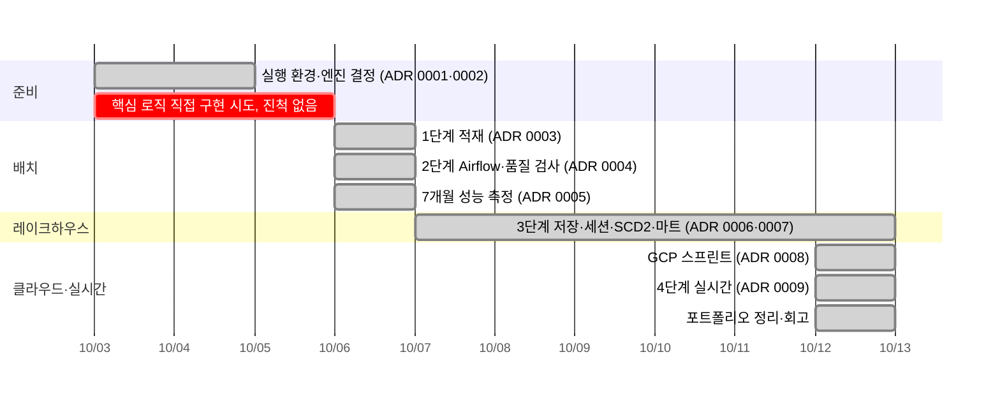
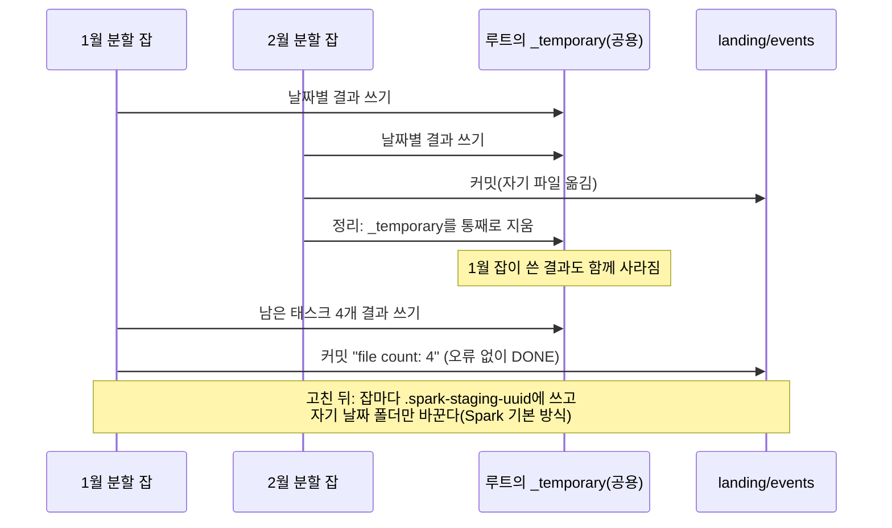
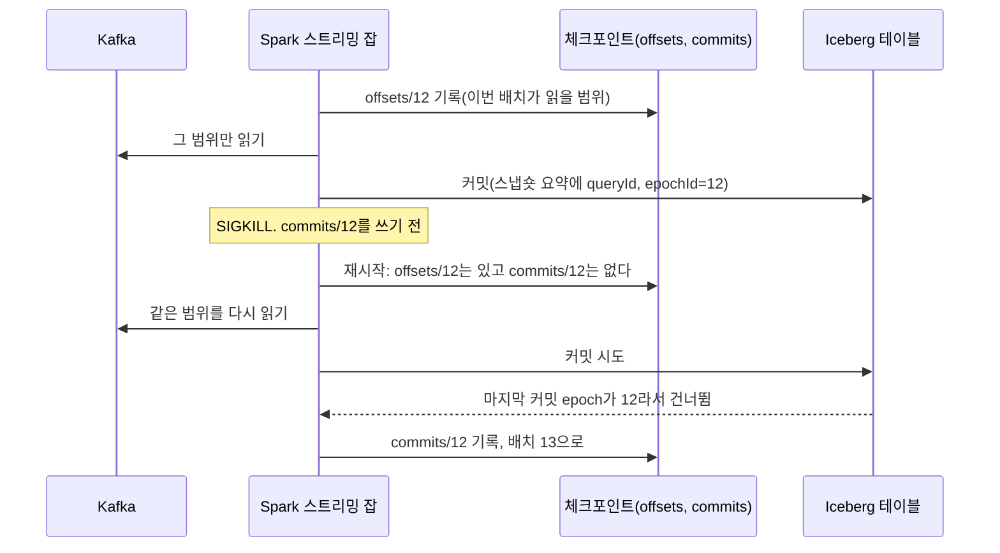

# 회고: B2C 이벤트 로그 파이프라인 (2026-10-03 ~ 10-12)

열흘 동안 배치 적재, 오케스트레이션, 레이크하우스 모델링, 클라우드 이전, 실시간 처리까지 네 단계를 끝냈다.
가장 값진 것은 기능 목록이 아니라 **결과를 파이프라인 밖의 계산과 맞춰 보는 습관**이었다. 그 습관 덕에 성공으로 끝난 클라우드 잡이 데이터를 잃은 것을 찾았다. 원천 데이터의 결함 다섯 가지도 같은 방법으로 찾았다.

근거는 모두 ADR([docs/decisions/](../decisions/))과 그림([charts.md](charts.md))에 있다.

## 진행

| 숫자 | 값 |
|---|---|
| 처리한 이벤트 | 410,325,314건, 213일 |
| 설계 결정 기록(ADR) | 9개, 모두 후보 비교와 트레이드오프 포함 |
| 자동 테스트 | 57개 |
| 찾은 원천 결함 | 5가지(아래 표) |
| 클라우드 비용 | 약 ₩1.2만(추정, 결제 기록 대조 전) |

## 잘된 것
**1. 결과를 독립 계산과 맞췄다.** 단계마다 "맞다"를 파이프라인 밖의 숫자로 확인했다.

| 단계 | 무엇과 맞췄나 | 결과 |
|---|---|---|
| 적재 | 날짜마다 landing 고유 행 수 = warehouse 행 수 | 213일 모두 같다 |
| 클라우드 | 날짜별 행 수를 로컬과 | 213일 모두 같다(410,325,314) |
| 마트 | 코호트 크기 합계, 카테고리 변경 수를 독립 쿼리와 | 15,639,803 / 168,736으로 같다 |
| 실시간 퍼널 | 같은 구간을 배치로 다시 센 값과 윈도마다 | 강제 종료 뒤에도 120개 윈도가 같다 |
| 실시간 세션 | 배치 세션과 하나하나(시작·끝·이벤트 수) | 103,053개가 같다 |

이 습관이 없었다면 놓쳤을 것이 둘 있다. 하나는 성공(DONE)한 잡이 1월 31일 중 27일을 잃은 일이다(ADR 0008). 다른 하나는 엔진이 보고한 "버린 수"가 실제로 버린 이벤트 수가 아니었던 일이다(ADR 0009).

**2. 숫자를 재서 정했다.** 짐작으로 정한 값이 없다.
- 동시 실행 수: 1~4개를 재서 메모리 한도 때문에 3으로 정했다(ADR 0005).
- 세션 검증 바닥: 일부러 고장 낸 세션의 값을 재서 정했다(ADR 0007).
- 워터마크: 5·10·20분의 손실·상태 크기를 같은 재생으로 쟀다(ADR 0009).

**3. 멱등성을 처음부터 넣었다.** 재시도·백필·강제 종료 어디서 다시 돌려도 결과가 같다.
- 날짜 단위 덮어쓰기(ADR 0003).
- SCD2는 차이만 MERGE한다. 다시 돌리면 커밋이 0이다(ADR 0007).
- 스트리밍은 체크포인트 오프셋과 Iceberg의 배치 번호 건너뛰기가 맞물린다(ADR 0009). 아래 그림 2.

**4. 비용 안전장치를 먼저 만들었다.** Composer는 일시정지가 없고, 첫 예산 알림은 약 4일 뒤에야 울린다. 그래서 매일 02:00에 환경을 지우는 작업을 만들고, 실제로 실행해 지워지는 것까지 확인한 뒤에 스프린트를 시작했다. 관리형 서비스는 만든 날 지웠다.

**5. 같은 코드가 노트북과 클라우드에서 돌았다.** DAG는 환경 변수 분기만 다르다. PySpark를 1단계부터 쓴 결정(ADR 0002)이 여기서 값을 했다.

## 잘못된 것과 배운 것
| 무엇이 | 왜 | 치른 값 | 배운 것 |
|---|---|---|---|
| Dataproc 기본 커미터가 동시 쓰기에서 데이터를 잃었다 | 클라우드 기본값이 "한 폴더에 한 번에 한 잡"을 전제했다. 공식 문서에 경고가 있었지만 미리 확인하지 않았다 | 클러스터 재생성과 분할 재실행 | 기본값은 이 프로젝트의 쓰기 패턴에서 검증된 것이 아니다. 스모크 테스트에 동시 실행을 넣는다(그림 1) |
| YARN 잡 7개가 27분 동안 실행기를 못 받았다 | 메모리만 계산했다. YARN은 코어도 센다 | 클러스터 재생성 | 자원 관리자가 무엇을 세는지부터 확인한다 |
| 세션 검증이 213일 중 61일에서 실패했다 | 11월 한 달로 정한 문턱을 7개월에 썼다. 원천의 세션 정의가 3/25에 바뀌었다 | 검증 규칙 재설계 | 한 구간에서 정한 문턱은 전체 기간에서 다시 잰다 |
| ADR에 적은 세션 일치율 기준값이 틀렸다 | 다른 정의(사용자별 한 달)로 잰 값을 적었다 | 기준 정정 | 기준값에는 정의와 계산 쿼리를 함께 적는다 |
| 엔진 지표를 이벤트 수로 읽었다 | `numRowsDroppedByWatermark`는 부분 집계된 행을 센다 | 대조 기준 재설계 | 지표의 단위는 테스트로 확인한다 |
| 세션 간격을 1,801초로 잡았다 | `session_window` 경계가 포함인지 짐작했다 | 테스트가 잡았다 | 경계는 짐작하지 말고 경계값 테스트로 고정한다 |
| Terraform apply가 바뀐 것 없는 클러스터를 다시 만들었다 | 두 가지였다. Dataproc이 저장한 권한 범위(scopes)가 코드와 달랐고, 파일 편집이 실패한 채 apply를 함께 돌렸다 | 재생성 한 번에 약 4분 | plan을 보고 apply한다. 인프라 변경은 한 번에 하나씩 한다 |
| 원천 결함이 품질 검사를 통과했다 | 규칙이 그날 데이터만, 이벤트 종류를 나누지 않고 본다 | 마트에 결함 날짜가 그대로 있다 | 지표를 그림으로 한 번 그려 보는 것도 검증이다. 구매 누락은 이 회고의 그림을 그리다 찾았다 |

찾은 원천 결함 다섯 가지:

| 결함 | 언제 | 어떻게 찾았나 | 대응 |
|---|---|---|---|
| 세션 id 정의 변경 | 2020-03-25부터 | 날짜별 세션 일치율이 하루 만에 계단처럼 바뀜 | 일치율 채점 대신 고장 감지 바닥 |
| 카테고리 재부여(아이폰 → 건설 공구) | 2019-12-01부터 | 카테고리 변경이 12/1 하루에 몰렸다. 11월 매출 1~3위인 아이폰이 그날부터 '건설 공구'로 나온다 | SCD2 as-of 조인. Type-1이면 11월 매출의 61%가 옮겨 감 |
| 장바구니 기록 누락 | 2019-10 | 구매 1건당 장바구니가 1.2(다른 달 2.5~3.0) | 달끼리 비교하는 기본 지표를 세션 전환율로 |
| 이벤트 급감 | 2020-02-27 | 날짜별 건수가 평소의 10% | 한계로 기록 |
| 구매 누락 | 2019-11-15, 2020-01-02(0건), 2020-04-20·21(22·29건) | 날짜별 구매 수 그림. 원천 압축 파일을 직접 세어 확인 | 한계로 기록, 달별 지표에서 제외 |

## 그림 1. 커미터가 데이터를 잃은 순서
ADR 0008의 드라이버 로그와 파일 수로 다시 그린 순서다. 2월 잡이 정리하면서 지웠다는 부분은 로그로 본 추정이다.

## 그림 2. 강제 종료해도 한 번만 반영되는 까닭
가장 위험한 순간(테이블 커밋 뒤, 체크포인트 기록 전)에 죽었을 때다. 실험 E2에서 재생 도중 `SIGKILL` 후 재시작했고, 120개 윈도가 배치와 같았다.

## 학습 방식
- 10/3~10/5에는 핵심 로직을 직접 짜는 방식이었다. 아직 모르는 것을 직접 결정해야 하는 구조가 병목이 되어 진척이 없었다.
- 10/6부터 Claude가 설계·코드·테스트를 맡고, 나는 단계마다 나오는 질문지로 "왜 이렇게 했나"를 블로그로 설명하는 방식으로 바꿨다. 그 뒤 엿새 만에 나머지 단계를 끝냈다.
- 대가도 분명하다. 코드를 손으로 짠 경험은 적다. 그래서 면접에서 설명할 수 있는지를 기준으로 삼고, 질문지에 "두 번 돌리거나 중간에 죽으면?" 같은 면접형 질문과 직접 돌려 볼 실험을 넣었다.

## 다시 한다면
1. **첫날 데이터를 그림으로 본다.** 날짜별·이벤트 종류별 건수를 처음에 그렸다면 2/27, 구매 누락, 10월 장바구니를 설계 전에 알았을 것이다.
2. **품질 규칙에 '최근 날짜 대비'와 '이벤트 종류별' 건수를 처음부터 넣는다.** '날짜는 그날 데이터만의 함수' 원칙의 예외지만, 이번에 놓친 결함이 모두 여기에 걸린다.
3. **클라우드로 옮기기 전에 쓰기 패턴을 작게 시험한다.** 같은 폴더 동시 쓰기, 덮어쓰기를 2~3일치로 먼저 돌려 본다.
4. **구현과 이해의 속도를 맞춘다.** 열흘 동안 구현이 설명보다 훨씬 앞서 나갔다. 면접에서 설명할 수 있어야 의미가 있는 프로젝트다.

## 남은 일
- 결제 기록으로 클라우드 비용을 확정한다(ADR 0008).
- 2026-12-06까지 GCP 리소스를 지운다(`terraform destroy`).
- 품질 규칙 보강: 최근 7일 중앙값 대비 건수, 이벤트 종류별 건수(ADR 0007 '다시 검토할 조건').
- 기간을 가로지르는 카테고리 분석이 필요해지면 옛·새 category_id 대응표를 만든다.
